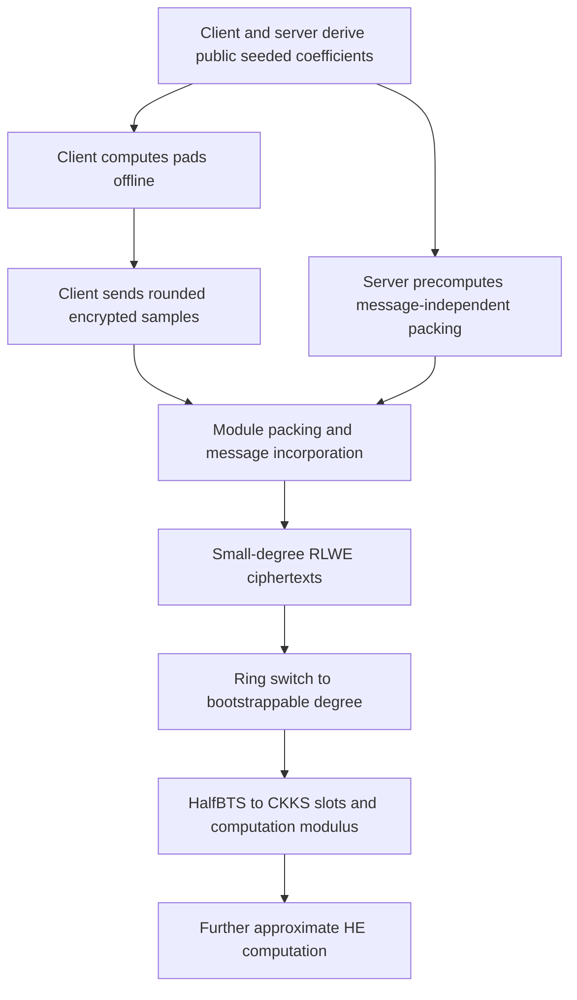

---
# Summary

## 1. Problem

Bae, Cheon, Kim, Park, and Stehlé study **ring packing**: convert many ciphertexts under a common LWE key into an RLWE ciphertext usable for batched HE. The supplied HERMES version is dated 1 March 2024. Its target is not merely placing messages in polynomial coefficients; the output should be slot encoded, at a useful computation modulus, with parameters supporting further CKKS computation and bootstrapping.

The transciphering application uses seeded, small-dimension LWE/MLWE symmetric encryption of approximate real values. Packing performs the conversion to CKKS, avoiding homomorphic evaluation of a separate finite-field stream cipher such as HERA or Rubato.

## 2. Main Contribution

Three ingredients are combined:

1. Perform expensive base packing at a **small modulus**, then use a partial CKKS bootstrap, `HalfBTS`, to obtain a high-modulus slot representation.
2. Pack initially into small-degree RLWE ciphertexts, then ring-switch them into the larger bootstrappable ring.
3. Use intermediate module-LWE representations to reduce the number of elementary switching keys required by the column packing method.

The result is a time/key-size tradeoff. One module midpoint substantially reduces base-packing key size while retaining a similar total runtime; bootstrapping keys remain a large part of the complete setup.

## 3. Main Techniques

Ring packing can be viewed as a public-matrix/encrypted-secret-vector multiplication: each input LWE ciphertext supplies a row of public coefficients, and the conversion keys encode the source secret under the target key.

The column method needs no modulus-consuming multiplication levels during base packing. It therefore benefits particularly strongly from delaying high-modulus operations until `HalfBTS`. The latter combines modulus raising, coefficient-to-slot conversion, and approximate modular reduction; it is not simply a free scale change.

MLWE interpolates between LWE and RLWE: rank $k$, ring degree $n$, and total secret dimension $kn$. `ModPack` combines several ciphertexts, regroups their key components, and applies hoisted module key switching to reduce rank while increasing message degree. Module key switching itself uses embedding into RLWE, ordinary RLWE key switching, and extraction back to MLWE.

For a source dimension $K$ and one midpoint rank $k$, the base key count is $K/k+k$, minimized near $\sqrt K$, instead of $K$ elementary keys. These are counts of structured switching-key objects, not complete system memory or individual scalar secret coefficients.

## 4. Threat Model and Assumptions

The evaluator does not know the LWE encryption secret or target HE secret. It receives appropriately generated switching/bootstrapping material and performs public conversions. Security relies on the concrete lattice dimensions, moduli, secret distributions, and the assumptions needed for the provided evaluation keys.

The paper targets approximately 128-bit lattice security in its reported transciphering configurations. Replacing a new stream cipher with a lattice-based symmetric encoding avoids that cipher's separate cryptanalytic assumptions; it does not make security unconditional or eliminate parameter selection.

Seeded generation of public LWE coefficients requires appropriate XOF behavior and unique sample derivation. Reusing the same pad for two plaintexts exposes their difference. The workflow is a confidentiality/conversion construction, not an authenticated or verifiable computation protocol.

## 5. Important Qualifications

The headline **41×** improvement is in **throughput at different batch sizes**: HERMES packs $2^{15}$ inputs in 10.2 seconds, while the quoted PEGASUS run packs $2^{12}$ in 51.7 seconds. The ratio is approximately $(2^{15}/10.2)/(2^{12}/51.7)=40.55$. This is not a 41-fold reduction in latency on an identical input batch. At matched batch sizes the paper reports roughly 3.8–7.7-fold latency gains for the comparison configuration.

The 10.2-second comparison uses output degree $2^{15}$ and approximately 270 modulus bits of remaining computation capacity. The default degree-$2^{16}$ configuration instead takes 30.7 seconds for $2^{16}$ inputs and has about 562 computation-modulus bits. These are distinct workloads and parameter sets.

Reported “worst” precision is the maximum error observed over **100 iterations**, not a proved worst-case error bound. Approximate encoding, rounding, key switching, and CKKS bootstrapping all contribute. The client may send individual LWE samples, but the server still accumulates/organizes inputs for the desired packed output; low client granularity does not imply constant low per-item conversion latency.

Algorithm 1's printed loop runs through $j=K/k'$ although the component family is defined for $0\le j<K/k'$. The endpoint would access outside that family. An implementation should use the strict upper bound from the surrounding construction. Section 5.4 also swaps HERA/Rubato citation labels in one introductory sentence; Table 11 gives the intended associations.

## 6. Evaluation Setup

The proof-of-concept is C++ in HEaaN on an AMD Ryzen 7 3700X, **single-threaded**. For $2^{16}$ input LWE ciphertexts of dimension $2^{11}$, base degree $2^{12}$, and input scale $2^{42}$, HERMES0 takes 29.1 seconds with 782 MB total keys; HERMES1 with a module midpoint takes 30.7 seconds with 673 MB. Mean/observed-worst precision is 23.8/21.1 bits and 24.9/21.8 bits respectively (Table 6).

Table 10 isolates base packing: the improved column method takes 231 ms with 113 MB of base keys; a single midpoint takes 374 ms with 5.31 MB. These exclude the complete output bootstrap, whose keys dominate much of the full configuration. Table 8's 10.2-second smaller-ring comparison uses 547 MB total keys.

Table 11 reports total offline-plus-online transciphering latency: degree $2^{16}$ HERMES takes 25.7 seconds at input block degree 16 and 30.9 seconds for individual samples. Quoted HERA and Rubato figures are 142 and 71.1 seconds for block size 16. These reference timings are imported from their respective papers, not a same-hardware rerun.

HERMES reports mean precision 23.0 bits and expansion 1.58, versus about 19-bit precision and 1.24–1.31 expansion for those reference configurations. Expansion excludes the amortized public seed and reusable evaluation keys. With 38 transmitted modulus bits and 24 signed precision bits, $38/24\approx1.58$; the denominator is not an arbitrary application datatype's storage size.

---
# Main Scheme

## Title

Seeded LWE input → module packing → small-ring RLWE → bootstrappable CKKS

### 1. Notation

- $K$: source LWE secret dimension; $s$: its secret.
- $N_b,N$: base ring and final bootstrapping degrees.
- $Q_{Enc},Q_{comp}$: low input modulus and post-conversion computation modulus.
- $\operatorname{MLWE}_{q,n}^{k}$: rank-$k$, degree-$n$ ciphertext format.
- $\Delta$: real-message encoding scale.
- `BaseHERMES`, `ModPack`, `HalfBTS`: packing and conversion procedures.

### 2. Seeded encryption and precomputation

Derive each public vector $a_i$ from a public seed and unique index. Using the source's sign convention, create

$$
b_i=\langle a_i,s\rangle+\Delta m_i+e_i\pmod{Q_{Enc}}.
$$

Encryption noise and quantization must be included even where the algebraic format absorbs them into the message. Transmit the required rounded/truncated $b_i$ values and seed metadata. The client can precompute its pad terms; the server can precompute base packing of public $a_i$ portions before the messages arrive.

### 3. Base packing through module midpoints

Group $N_b$ inputs. Apply `ModPack` stages that combine message coefficients and reduce secret rank. A one-midpoint organization has the shape

$$
N_b\cdot\operatorname{LWE}^{K}
\longrightarrow k\cdot\operatorname{MLWE}^{k}_{Q_{Enc},N_b/k}
\longrightarrow\operatorname{RLWE}_{Q_{Enc},N_b}.
$$

Use the prescribed key embeddings, twists, key switches, and extraction maps. Intermediate components are not necessarily standalone encryptions of the desired message; correctness is established for their assembled sum.

### 4. Ring switch and finish conversion

Combine the small-ring ciphertexts and switch to the appropriate target secret in degree $N$. Coefficient rearrangement itself is cheap, while key switching still has cost and noise. Incorporate the received message-dependent $b_i$ terms into the precomputed result when using the offline/online split.

Apply `HalfBTS` to obtain the slot-encoded ciphertext at $Q_{comp}$. Subsequent CKKS computation operates on the recovered approximate real values. Its remaining modulus budget and precision must be included when comparing this output with another transciphering method.

## Protocol

# Questions

- How many useful inputs are packed before a server output is required?
- Does the comparison match remaining HE levels, precision, and actual batch size?
- How large are all conversion and bootstrap keys, rather than only base-packing keys?
- How are sample indices persisted so seeded pads never repeat?
- What failure/precision guarantee is needed beyond the observed errors in 100 trials?

# Related Topics

[[000 - Transciphering HE]]; LWE symmetric encryption; module-LWE; ring packing; ring switching; CKKS; HalfBoot; seeded ciphertexts; PEGASUS.
