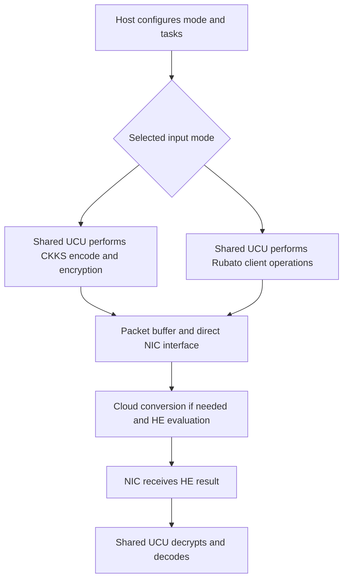

---
# Summary

## 1. Problem

Zhao et al., arXiv:2512.18589v1 (21 December 2025), study edge-device costs in outsourced encrypted computation. Direct RNS-CKKS encryption needs substantial arithmetic and sends expanded ciphertexts. Rubato-based hybrid HE reduces client work and upload size but moves transciphering work to the cloud.

**DNA-HHE** is a configurable client-side hardware architecture supporting both paths, coupled directly to a network interface. Its contribution is an accelerator and data-transfer design; it is not a new transciphering cipher or cloud conversion algorithm.

## 2. Main Contribution

A unified datapath performs CKKS encoding/encryption and decryption/decoding, as well as Rubato's finite-field computations. Custom task/configuration instructions select parameters and operations. A task manager tracks functional-unit and buffer conflicts to overlap independent work.

The near-network interface assembles/disassembles packets and moves ciphertexts directly between accelerator buffers and the NIC. This avoids the standalone architecture's extra accelerator-to-memory and memory-to-NIC transfers. A shared butterfly unit and specialized modular reduction reduce FPGA DSP requirements.

## 3. Main Techniques

The unified crypto unit supports FFT/IFFT fixed-point arithmetic, NTT/INTT modular arithmetic, pointwise operations, and matrix-vector multiply-accumulate. Two butterfly units provide two-way computational parallelism. The supported modular datapaths are up to 56 bits for RNS-CKKS and 28 bits for Rubato, with 29-bit signed fixed-point complex components and a stated precision parameter of 26.

RNS primes are selected in the form $q_i=2^k-2N\,b_i+1$. Their structure permits shift/add and narrow-multiplier implementations of Barrett reduction. For the tested 54-bit configuration, the authors report enough suitable primes using 10-bit $b_i$ values. This is a parameter-dependent arithmetic optimization, not support for arbitrary primes at the same cost.

Rubato's circulant linear layers use column-oriented scheduling so state values can be reused with local accumulators. The nonlinear layer computes neighboring quadratic terms with pipelined multiply-accumulate while preserving the required prior-state values. Shared units execute the different round/block configurations under instruction control.

## 4. Threat Model and Assumptions

The edge retains its HE secret key and symmetric key. The cloud receives HE ciphertexts directly or compact Rubato ciphertexts plus required encrypted-key/setup material. Confidentiality inherits the selected CKKS/Rubato parameters and complete protocol; this hardware paper does not provide a new security reduction.

It does not demonstrate side-channel protection, fault resistance, NIC isolation against a hostile host, or malicious-cloud result verification. Packet handling accelerates transport but does not itself provide authenticated transport or nonce management.

## 5. Important Qualifications

The claimed 1.09–1.56× near-network gains cover **edge-side** preparation/transfer or receive/decryption. They do not include Internet delay, the cloud's homomorphic application, or Rubato-to-CKKS transciphering. The full deployment's preferred mode can therefore differ from the faster edge-side mode.

Table III compares **cycle counts** across a CPU and FPGA with different clock frequencies. Its 5.6–8.5× ratios are not elapsed-time speedups across those platforms. Table IV likewise normalizes area and cycles by the **state block size**, whereas Rubato's output lengths are 12/32/60 for state sizes 16/36/64. Output throughput comparisons must use the actual emitted payload and platform frequency.

The cross-cipher comparison is against PASTA hardware, so it does not hold the symmetric algorithm, HE backend, or every parameter constant. In addition, Table IV labels its PASTA-3 block as 64, whereas the reference PASTA-3 construction uses a 256-word key and 128-word output block. The comparator's precise hardware instance and normalization need reconciliation before treating the ratio as a matched-payload comparison.

Rubato is a **noisy approximate cipher** in its original specification. This paper's algorithm sketch emphasizes the deterministic finite-field core and does not fully specify the final Gaussian perturbation, real encoding, precision budget, and complete RtF conversion. Those details must come from the Rubato scheme; the sketch alone is not a complete encryption specification. “No expansion” for a finite-field cipher core also does not include all real-number encoding, nonce, or reusable HE setup costs.

ASIC figures are synthesis results in a stated process, with normalization for comparisons; they are not a fabricated-chip measurement. FPGA results, software results, simulated bus transfers, and normalized ASIC area must remain distinct.

## 6. Evaluation Setup

The Chisel design is integrated into Chipyard with a Rocket CPU, TileLink, and an IceNet NIC. It is instantiated on a Xilinx Kintex-7 KC705 using Vivado and synthesized for TSMC 28 nm HPC+ using Synopsys tools. Network loopback correctness is checked against FullRNS-HEAAN and Rubato references.

For $N=8192$ and three 54-bit RNS primes, Table II gives FPGA encode+encrypt 1.79 ms, decrypt+decode 0.29 ms, total 2.08 ms at 200 MHz. Resources are 18,686 LUTs, 10,444 FFs, 36 DSPs, and 91.5 BRAMs. The ASIC synthesis row at 500 MHz gives approximately 0.83 ms total; its displayed area is normalized for the comparison.

Table III reports Rubato Par-128S/M/L cycle counts 1235/2087/3036. At the stated 200 MHz FPGA clock these correspond to about 6.18/10.44/15.18 microseconds for the timed operation. These conversions do not add any omitted enrollment, cloud processing, or network work.

Bus experiments vary one/two channels and 64/128/256-bit TileLink widths. The standalone modeled transfers account for 16.72–33.11% of upload-side time and 30.13–50.55% of receive-side time. The near-network approach reports 1.15–1.43× upload-side and 1.09–1.56× receive-side acceleration. Both use this design's same crypto times, isolating the modeled transfer-path difference.

---
# Main Scheme

## Title

Instruction-controlled edge encryption with a shared datapath and direct NIC transfer

### 1. Notation

- $m$: client message; $N$: CKKS polynomial degree.
- $Q=\prod_iq_i$: CKKS ciphertext modulus in RNS form.
- $t,n,\ell,r$: Rubato field modulus, state size, emitted word count, and round count.
- UCU / NIU: unified crypto unit / network interface unit.
- BFU: butterfly unit shared across arithmetic modes.

### 2. Configure the selected mode

The host loads keys, public constants, transform tables, memory locations, and network headers. Task instructions configure CKKS or Rubato arithmetic. The paper supports mode selection; it does not demonstrate an autonomous controller proving an optimal choice from measured cloud congestion.

### 3. Direct CKKS path

Encode $m$ using IFFT, scaling, and coefficient conversion. Sample the required encryption randomness/errors, transform and compute across the configured RNS primes, and produce the two ciphertext polynomials. The task manager overlaps independent tasks while tracking buffer hazards.

### 4. Hybrid path

Run the selected Rubato instance using public nonce-derived material and shared finite-field units. Combine its output with the properly encoded message following the original noisy encryption specification. Supply the cloud with the protocol's required encrypted key/setup material; the client-side accelerator does not replace that setup.

### 5. Network and return path

Transfer ciphertext segments into packet buffers after the configured headers and transmit through the direct NIC connection. The cloud either processes CKKS inputs directly or first performs the hybrid scheme's transciphering.

On return, receive and unpack HE ciphertexts, perform CKKS decryption under the client's key, and decode. The returned result is still an HE ciphertext in the described HHE workflow; the paper does not demonstrate compact symmetric return conversion.

## Protocol

# Questions

- Does a workload's edge-side gain survive the additional cloud transciphering cost?
- Are comparison rates measured per emitted payload word or per internal state word?
- Where are Rubato noise sampling, nonce uniqueness, and encrypted-key enrollment implemented?
- What arithmetic/correctness tests cover every supported prime and instruction combination?
- Are side-channel protection and authenticated networking required beyond this architecture?

# Related Topics

[[000 - Transciphering HE]]; Rubato; RNS-CKKS; edge accelerators; near-network computing; FPGA; resource sharing; Barrett reduction.
