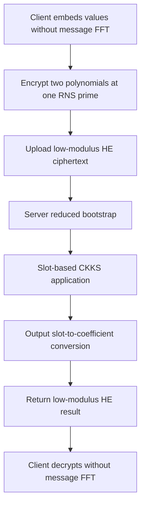

---
# Summary

## 1. Problem

Aikata, Krieger, and Roy address client-side CKKS computation, memory, and communication. Their **Boosted-Deflation** approach shifts public representation transforms and modulus restoration to the server, allowing the client to encrypt at one RNS prime and avoid the usual floating-point FFT encoding/decoding.

This is a low-level HE input/output optimization rather than ordinary symmetric-to-HE transciphering. It belongs next to transciphering because it offers a different tradeoff between client cost, ciphertext expansion, and server preprocessing.

## 2. Main Contribution

**Deflate** moves message encoding/decoding transforms to the evaluator. **Boost** encrypts at the lowest configured modulus and uses server bootstrapping to restore computation capacity. Combining them lets the evaluator omit the initial `SlotToCoeff` step of a conventional bootstrap because the client supplied coefficient-form data already.

The server runs a reduced bootstrap (`Small-Boot`), evaluates the application, and converts the result to the coefficient representation needed for simple client decryption. The paper provides software, an FPGA prototype, ASIC synthesis estimates, and projected microcontroller results.

## 3. Main Techniques

With $Q=\prod_{i=0}^{L}q_i$, conventional client encryption processes all $L+1$ RNS residues. Boost instead sends two ciphertext polynomials modulo one prime $q_0$. It reduces the residue-polynomial upload and associated transforms by approximately $L+1$, before fixed overheads and parallel execution effects.

Deflate embeds scaled input values directly into the coefficient representation used by the modified interface. The evaluator uses CKKS's public linear transforms to reach the slot representation for computation and converts the result back before return. Integer NTTs remain on the client; it is the floating-point message FFT/DFT that is removed.

The combined path begins with coefficient-form low-modulus ciphertexts, so the first `SlotToCoeff` transform is omitted. Modulus raising, coefficient-to-slot work, and approximate modular reduction still occur. This changes the distribution of work; it does not eliminate bootstrapping or its approximation error.

## 4. Threat Model and Assumptions

The client retains its HE secret key and supplies the evaluator the normal public/evaluation material. The analysis relies on the selected RLWE/CKKS parameters, distributions, and correct implementations of representation transforms and bootstrapping.

The intended confidentiality model is ordinary outsourced HE. The paper discusses chosen-decryption-related CKKS issues, but does not prove that mandatory initial bootstrapping alone provides general IND-CPAD security or malicious-server verification. Releasing decrypted outputs to an adversary still requires the relevant output-security analysis.

## 5. Important Qualifications

**The PASTA depth comparison in Appendix E is incorrect.** It multiplies a depth-five PASTA-4 evaluation by 1024 independent instances and calls the result depth 5120. Independent evaluations increase total work, not their longest dependency path. Consequently the claimed 320-fold depth advantage over a depth-16 bootstrap is not a sound depth comparison. The appendix's naive dense-matrix multiplication counts also do not capture all PASTA packing and implementation optimizations. They should not establish a general ranking against HHE.

The text sometimes conflates NTT representation of ciphertext polynomials with CKKS message-slot encoding. An NTT is a computational representation for modular polynomial arithmetic; it does **not** by itself change the encrypted message from coefficient to CKKS slot representation. The scheme must be understood through the explicit client/server transforms and Algorithms 4–5.

Some displayed inline formulas retain crossed-out encoding/depth terms. Table 2 and Appendix F are the clearer specification: no client IDFT, one-prime encryption, server preprocessing, server output conversion, and decryption without client DFT.

“Same precision” should mean compatibility with the chosen **post-bootstrap** precision target, not exact preservation of every input bit or equality of ciphertext distributions after homomorphic transforms. Likewise, the familiar RLWE assumption is conditional; smaller modulus, decryption correctness, and concrete lattice security are related constraints, not interchangeable proofs of safety.

The baseline already returns a lowest-level ciphertext. Table 3 therefore shows **unchanged download size**, 0.98 MB, for all variants. The large communication reduction is principally in upload. Key generation, evaluation-key upload, and reusable server storage are outside this steady-state comparison. A one/two-extra-bootstrap estimate is workload/schedule dependent, not a bound for every arbitrary program or parameter configuration.

## 6. Evaluation Setup

Software adapts HEAAN on an Intel Core i7-1260P. The reported configuration has $N=2^{16}$, 128 occupied slots, $L=28$, error standard deviation 3.2, and secret Hamming weight 64. Table 3 reports encryption/decryption 204.3/41.2 ms conventionally versus 28.2/14.2 ms combined. Upload falls from 28.0 to 0.98 MB; download stays 0.98 MB. Allocated program memory falls from 261.4 to 233.26 MB against a 233 MB baseline, so this is a reduction in incremental ciphertext storage, not elimination of the whole program footprint.

The same table's **15.1 ms additional server time uses a separate FPGA accelerator model**, while its software bootstrap reference is 9.7 seconds. Client CPU and server-accelerator numbers must not be presented as a single all-software measurement.

FPGA measurements use a Kintex-7 Genesys2 at approximately 190 MHz, with 31,421 LUTs, 34,887 FFs, 204 DSPs, and 326 BRAMs. For degree $2^{16}$ and a 60-bit first prime, encryption/decryption take 3.78/2.64 ms. ASIC synthesis at 1 GHz predicts 0.70/0.49 ms, with 3.36 mm² at 28 nm or 0.22 mm² at 7 nm. These are synthesis projections, not silicon measurements.

Cortex-A7/M4 timings are extrapolated from Embedded SEAL to larger, bootstrappable parameters, not runs of the complete proposed protocol on those devices. Application analyses include MNIST logistic regression and CIFAR CNN inference, combining modeled communication with cited server accelerators. Claims about small server overhead depend on those workloads and accelerated preprocessing; shallow jobs can be dominated by the extra bootstrap.

The paper supplies a public implementation at [Client_Boost_Deflate](https://github.com/aikata10/Client_Boost_Deflate). These notes do not assert that the external repository was executed or independently audited.

---
# Main Scheme

## Title

One-prime coefficient-form encryption with server-side reduced bootstrapping

### 1. Notation

- $R_q=\mathbb Z_q[X]/(X^N+1)$; $Q=\prod_{i=0}^{L}q_i$.
- $s$: client HE secret; $pk=(pk_0,pk_1)$.
- $\mu$: prescribed coefficient-form message embedding; $\Delta$: scale.
- $v,e_0,e_1$: fresh encryption randomness and errors.
- `Small-Boot`: bootstrap omitting the initial `SlotToCoeff`.

### 2. Setup and input representation

Generate compatible CKKS keys and evaluation material for the entire server computation. Specify exactly how input values occupy $\mu$ and how scales/bounds fit $q_0$. The client need not perform a floating-point IDFT, but still needs the specified embedding, scaling, and modular arithmetic.

### 3. Client encrypts at one prime

Compute, using the source's public-key sign convention,

$$
c_0=v\,pk_0+\Delta\mu+e_0\pmod{q_0},\qquad
c_1=v\,pk_1+e_1\pmod{q_0}.
$$

NTTs accelerate these polynomial operations. Transmit the two low-modulus polynomials. They are HE ciphertexts, rather than ordinary symmetric ciphertexts under a separate stream-cipher key.

### 4. Server restores the computational representation

Apply `Small-Boot` with the appropriate modulus raising, coefficient-to-slot transform, and modular reduction. Because the input is already coefficient-form, omit the conventional initial slot-to-coefficient step. Produce a ciphertext with the intended slot values, precision, and remaining level budget.

### 5. Evaluate and prepare the reply

Evaluate the application's CKKS circuit, including any subsequent bootstraps required by its schedule. Apply the prescribed output slot-to-coefficient conversion, scales, and modulus reduction so the client can recover the intended result directly. This output conversion is real server work even when combined into another scheduled routine.

### 6. Client decrypts

Compute

$$
\mu'=\Delta_{out}^{-1}\operatorname{Center}_{q_0}(c'_0+c'_1s).
$$

Use an INTT where the returned polynomials are in NTT form and interpret the agreed coefficient layout. No client-side message DFT is required. Correctness remains approximate and depends on the output scale, value bounds, and accumulated errors.

## Protocol

# Questions

- What precise coefficient layout and scaling make input/output conversion correct for complex versus real data?
- Does a shallow workload benefit after paying the initial bootstrap and output transform?
- Are comparisons based on measured complete execution or mixed CPU/hardware projections?
- What precision and chosen-decryption protections are required by the application?
- How does a corrected, equal-workload comparison with PASTA or HERMES change the claimed tradeoff?

# Related Topics

[[000 - Transciphering HE]]; CKKS; low-modulus encryption; HalfBoot; coefficient-to-slot conversion; client acceleration; ciphertext expansion; RNS.
