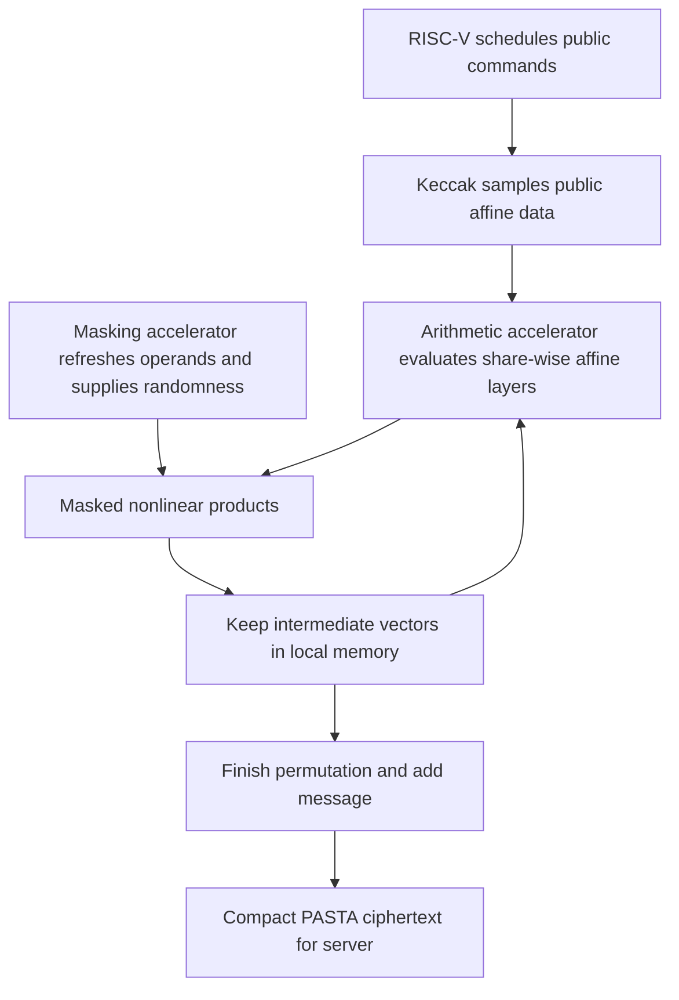

---
# Summary

## 1. Problem

Malal, Tosun, Yayla, and Savaş implement client-side PASTA on **RISQrypt**, an existing RISC-V hardware/software platform for lattice-based post-quantum cryptography. Dedicated PASTA hardware can be fast but adds a cipher-specific datapath, while unprotected embedded execution exposes physical side-channel risks.

The work asks whether existing arithmetic, Keccak, and masking accelerators can support PASTA efficiently, including first-order arithmetic masking, **without new PASTA-specific RTL**. It accelerates ordinary client encryption; it does not benchmark homomorphic PASTA decryption on the server.

## 2. Main Contribution

A software-controlled command schedule implements PASTA-3 over $\mathbb F_{65537}$, with a 256-field-element key and 128-field-element output block. It reuses arithmetic vector operations for affine/nonlinear layers, SHAKE128 hardware for public sampling, and masking hardware for refreshing and randomness.

An optional memory optimization keeps intermediate vectors in accelerator-local memory. A two-share masked version evaluates linear maps share-wise and nonlinear products using refreshed operands and a randomized multiplication gadget. A focused TVLA experiment tests that multiplication gadget on an Artix-7 FPGA.

## 3. Main Techniques

The arithmetic block is called NTT-Lite, but PASTA uses its coefficient-wise operations, **not an NTT**. Each matrix-vector row uses pointwise multiplication and reduction; sequential matrix structure lets the implementation keep only the current public row and derive the next one. Nonlinear Feistel layers use a shifted vector, square, and addition; cubes use two products.

The processor issues commands, addresses, and public parameters; state arithmetic and key movement are handled by the accelerator. Chaining commands avoids repeated load/store transfers between short vector operations.

For arithmetic shares $a=a^{(0)}+a^{(1)}\pmod p$, linear operations run on each share separately. Public affine constants must be added to only one share. Nonlinear multiplication introduces fresh $\rho$ and computes two output shares whose sum is the product. Operands are refreshed before the nonlinear calls, including correlated-input square/cube computations.

Public matrices and constants use domain-separated SHAKE128 streams. The standard path samples 17-bit candidates with rejection. For nonzero matrix elements only, $\operatorname{low}_{16}(w)+1$ gives an exactly uniform element of $\{1,\ldots,65536\}$; it is an optional alternative whose byte-for-byte deterministic stream differs from rejection sampling. Round constants still need the specified full-field sampling.

## 4. Threat Model and Assumptions

The protection targets **first-order physical leakage** of masked state arithmetic. It assumes suitable fresh randomness, correct operand refreshing, and a hardware/software execution schedule compatible with the gadget's leakage assumptions. Keeping secrets off the CPU arithmetic datapath reduces one exposure path; it does not prove the entire device, bus, key-loading path, or external memory is leakage-free.

The cryptanalytic security target remains that of the selected PASTA instance. Masking is a separate implementation countermeasure, not a strengthening of the abstract cipher against mathematical attacks. The work does not establish protection against higher-order attacks, fault injection, or arbitrary multi-probe/glitch leakage across the whole platform.

## 5. Important Qualifications

TVLA is conducted on **masked multiplication**, the nonlinear building block, not a complete end-to-end leakage certification of every cipher stage. Passing a fixed-versus-random first-order test at the tested trace count means leakage was not detected by that test. It does not prove absence of exploitable leakage.

“No additional hardware” is incremental relative to an existing RISQrypt platform **already containing the required masking hardware**. The paper separately quotes smaller unmasked versus larger masked platform resource counts; this does not mean a bare unmasked platform acquires physical masking support at zero area.

The 9.68× and 9.85× speedups compare each co-design with its corresponding unmasked/masked software baseline on the same core. They are not the overhead of masking. From the co-design cycle counts, masking adds about 54% to the timed encryption cost.

Per-bit figures divide by the **17-bit storage width** of each field element. They should not be interpreted as cycles per bit of arbitrary uniformly packed application entropy. Cross-platform CPU, Cortex-M4, and dedicated-FPGA cycle comparisons do not imply the same wall-clock ratios.

The background's cipher-family classification loosely associates LowMC/Rasta with prime-field arithmetic. Their original designs are binary; this introductory shorthand is not used as a specification here. The authoritative implementation target in this paper is PASTA-3 over the stated prime field.

## 6. Evaluation Setup

The implementation reuses the RISQrypt bitstream for an Artix-7 XC7A100T. RISC-V software is compiled with `-O3`; cycle counters measure one PASTA-3 block, with the same public sampling procedure for the principal software/co-design comparisons.

Table 2 reports unmasked software 9,267,385 cycles versus co-design 957,164; masked software 14,485,786 versus co-design 1,470,299. Output is 128 field elements. These correspond to about 7478/11,487 co-design cycles per element and 440/676 cycles per stored 17-bit output unit. HE key enrollment and server transciphering are outside these figures.

Without local-memory chaining, co-design costs rise to 1,508,605 unmasked and 2,295,773 masked cycles. Disabling matrix-element rejection saves less than 0.7%; standard rejection remains enabled in the main results.

Table 4 profiles blocks separately and totals 1,021,734 / 1,542,799 cycles, slightly above end-to-end measurement because of instrumentation. These totals should not replace Table 2. Arithmetic accounts for about 97–98% of those profile totals. Code/data footprints are 2864/3880 bytes for the co-design versus 14,288/14,932 for software; these exclude accelerator RAM and total FPGA area.

TVLA uses ChipWhisperer Husky and a CW305 Artix-7 at 40 MHz with four samples per cycle. With PRNG disabled, 1000 traces detect leakage; with PRNG enabled, 100,000 traces keep the reported absolute first-order Welch statistic below 4.5. The external source and analysis scripts are reported at [RISQrypt](https://github.com/cisec-su/RISQrypt); these notes do not claim an independent reproduction of those experiments.

---
# Main Scheme

## Title

PASTA-3 client encryption through reusable vector accelerators with two-share masking

### 1. Notation

- $p=65537$, $t=128$, $r=3$.
- $k=(k_L,k_R)\in\mathbb F_p^{2t}$; $N,i$: public nonce and block counter.
- $x=x^{(0)}+x^{(1)}$: two-share state.
- $M,c$: public affine matrix and constant.
- $\rho$: fresh field mask for each masked product instance.

### 2. Load and share the key

Transfer the key to the prescribed accelerator memory. Create/refresh the two-share representation for the masked path. The CPU schedules operations while state arithmetic remains in the accelerator. Initialize the unique public nonce/counter and sampling-domain counters.

### 3. Generate public affine data

Use SHAKE128 on the specified nonce/counter/domain seed. Sample the matrix generators and constants with the selected specification-compatible procedure. Generate each sequential matrix row as needed, retaining only the local data required for the next dot product.

For an affine layer, compute $Mx^{(0)}+c$ and $Mx^{(1)}$, then apply the fixed cross-branch mixing separately to both share vectors.

### 4. Evaluate masked nonlinear layers

After the required refreshing, compute the product of shared $a,b$ with

$$
c^{(0)}=a^{(0)}b^{(0)}-\rho,
$$

$$
c^{(1)}=a^{(0)}b^{(1)}+\rho+a^{(1)}b^{(0)}+a^{(1)}b^{(1)}.
$$

Their sum is $ab$. Implement the ordered masked accumulation so unmasked cross-term sums are not materialized. This reconstruction identity checks functional correctness; physical leakage security additionally depends on the implementation assumptions.

Use one such square for the shifted Feistel update and two products for a cube, with fresh masks and the specified operand refreshes. Neighboring Feistel updates use the original layer input, not an accidental in-place recurrence.

### 5. Produce the client ciphertext

Complete the initial/intermediate/final affine layers in the PASTA round order, take the left $t$ field elements as keystream, and add them to the message modulo $p$. The final externally released symmetric ciphertext is unshared as required by the protocol; intermediate secret state remains protected during the evaluated masked schedule.

The server later regenerates public affine data and homomorphically decrypts using the previously supplied HE-encrypted key. This server operation is part of the motivating HHE workflow, not the hardware benchmark.

## Protocol

# Questions

- Does complete-cipher leakage testing cover key loading, memory transfers, refreshes, and transitions between operations?
- What assumptions make correlated-input square/cube gadgets first-order secure on this accelerator?
- Is random generation uniform, fresh, and sufficiently fast under the actual command schedule?
- Is the optional no-rejection sampler intended to preserve only distribution or also interoperability with a fixed nonce stream?
- How do total platform area and elapsed time compare after including the preexisting masking subsystem?

# Related Topics

[[000 - Transciphering HE]]; PASTA; arithmetic masking; TVLA; RISC-V; hardware/software co-design; PQC accelerator reuse; local-memory scheduling.
