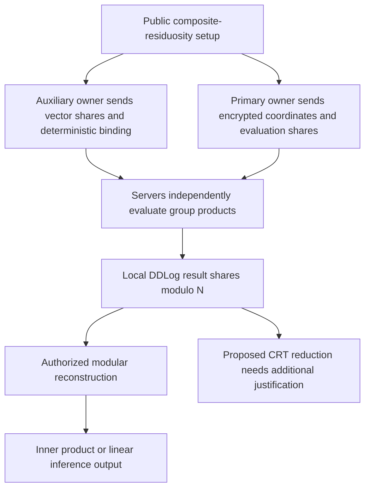

---
# Summary

## 1. Problem

Yang et al. propose **ConvertInput-Free Vector Homomorphic Secret Sharing** for two-server vector computations. Traditional restricted-multiplication HSS uses a `ConvertInput` procedure before arithmetic on inputs, with additional key decomposition in some constructions. This paper instead gives clients separate vector-preparation interfaces for auxiliary shares and primary encrypted vectors, followed by local server inner-product evaluation.

It is an HSS/vector-computation paper, **not a symmetric-to-HE transciphering scheme**. Its placement in this collection is adjacent background on alternative encrypted-computation architectures. The supplied document has substantive security and correctness issues described below; its claimed theorems should not be treated as independently validated guarantees.

## 2. Main Contribution

The proposed interfaces are public-key generation, `CGen1` for auxiliary vector data, `CGen2` for primary encrypted inputs and split evaluation randomness, and local server evaluation. For one inner product the method uses approximately $d+1$ group exponentiations rather than $2d$, without server-side `ConvertInput`.

CRT batching combines several auxiliary vectors so one primary vector can be evaluated against them in one batched operation. The paper builds distance-related scores, interactive comparison, matrix-vector multiplication, hierarchical image retrieval, and outsourced linear inference from these tools.

The claimed privacy assumption is decisional composite residuosity (DCR). The intended adversaries are two **noncolluding semi-honest servers**, with clients also following the protocol. A malicious-secure extension is left to future work.

## 3. Main Techniques

Let $N=pq$ be a safe-prime composite modulus, $g$ lie in the specified residue subgroup modulo $N^2$, and $h_i=g^{v_i}$ be public. Auxiliary preparation for $y$ produces subtractive shares $y_0-y_1=y$ and a common binding value

$$
A_y=\prod_{i=1}^{d}h_i^{y_i}\pmod{N^2}.
$$

Primary preparation for $x$ produces $I_i=h_i^u(1+N)^{x_i}$ and evaluation shares $u_1-u_0=u$. Server $\sigma$ computes a product combining $I_i^{y_{\sigma,i}}$ with $A_y^{u_\sigma}$. Taking the ratio between the servers cancels the blinding exponents and leaves $(1+N)^{\langle x,y\rangle}$.

The local `DDLog` map converts such multiplicative ratios into **subtractive result shares modulo $N$**. CRT batching replaces $y$ with $\sum_j\phi_j y_j$ and $A_y$ with $\prod_j A_{y_j}^{\phi_j}$, using CRT idempotents $\phi_j$ for pairwise coprime moduli $\psi_j$. This requires careful integer-lift and overflow reasoning in addition to the group identity.

## 4. Threat Model and Assumptions

Both servers individually receive the deterministic auxiliary binding. They must not combine their vector or evaluation shares. Private transmission protects share distribution; local inner-product evaluation itself needs no server interaction, but comparison and retrieval coordination do.

The proofs invoke high-dimensional entropy/leftover-hash reasoning as well as DCR. A dimension threshold alone does not provide entropy for an arbitrary fixed or highly structured vector. The experiments use approximately 1026-bit composite moduli constructed from 512-bit safe-prime factors' halves; the paper does not establish a 128-bit concrete-security comparison against modern lattice HE merely by using these parameters.

The outsourced “inference” construction demonstrated here computes $Wx$ and returns shares. It is not a demonstrated complete nonlinear neural-network inference pipeline.

## 5. Important Qualifications

**Auxiliary-vector privacy has a direct candidate-testing issue.** A server knows $h_i$ and $A_y$. For any candidate $\hat y$ it can compute $\prod_i h_i^{\hat y_i}$ and compare with $A_y$. It can therefore distinguish, for example, the all-zero vector from a unit vector: their bindings are $1$ and $h_1$ whenever $h_1\ne1$. This holds at arbitrarily large dimension and does not require factoring $N$. Low-entropy vector dictionaries and repeated bindings are likewise exposed. The theorem's claimed arbitrary-input simulation privacy cannot simply follow from the stated dimension condition. A more restricted source-entropy model would need explicit formulation and a valid proof; these notes do not assume such a repair.

**Result-share signs are inconsistent.** Definition 2 writes reconstruction as $z_0+z_1$, but Figure 8's derivation and the inference section give $z_0-z_1=\langle x,y\rangle\pmod N$. The scheme below uses the latter convention, which matches its algebra.

**The same-client `AddI` rule is not algebraically valid as printed.** Multiplying $I_x$ and $I_y$ yields blinding exponent $u_x+u_y$. Figure 1 says the evaluation key is not updated for same-client operands. Even if the client reused one $u$, the product has exponent $2u$, so keeping $u$ does not cancel it. Correct key bookkeeping must follow the actual exponent sum.

**CRT extraction needs an additional justification.** From $z'_0-z'_1=z\pmod N$ it does not follow that separately reducing shares modulo unrelated $\psi_j$ gives shares of $z\pmod{\psi_j}$. A difference may contain an extra multiple of $N$. Centering both local shares does not always fix this. For example, with $N=253$, centered local DDLog values $-109$ and $108$ differ by $-217=36-253$; modulo 5 this is 3, whereas $36\bmod5=1$. This challenges the printed extraction argument, not the elementary ratio identity. A correction or explicitly bounded failure analysis is needed before accepting batched correctness.

Appendix A's leftover-hash extension also changes the input distribution and treats the two prime reductions as independent despite their common small-integer source. The stated proof needs further work. Published parameter inequalities and experimental success do not settle these issues.

Finally, “exact retrieval” searches only the selected leaf cluster. Without a global-search or nearest-neighbor coverage argument, it is exact within that candidate set, not necessarily globally exact top-$K$ retrieval. Revealed comparison decisions, traversal paths, and cluster membership also need an explicit leakage model; this is not automatically conventional access-pattern-private PIR.

## 6. Evaluation Setup

Experiments use Python 3.12 and GMP-backed integers on Windows 11, Intel Core i5-12600KF at 3.70 GHz with 32 GB RAM, averaged over 100 trials. Core tests compute twenty inner products with random 32-bit coordinates and dimensions 128–1024. Table 2 reports 1024-dimensional cost 10.8 seconds without batching and 0.63 seconds with batch size twenty.

The compared older schemes include conversion costs of 152.6/21.8 seconds and inner-product costs 25.0/24.2 seconds. Thus the table totals are **177.6** and 46.0 seconds; nearby prose says 175.6 for the first total. Ratios using the table are approximately 282× and 73× versus 0.63 seconds. These are measured computational comparisons of the supplied implementations, not acceptance of the security/correctness claims above. Some table citation numbers also differ from the prose's references.

Image retrieval uses CIFAR-10, ResNet50 features, PCA, and fixed-point scaling $10^5$. All participants run as processes on **one machine**; network latency is excluded. At 2000 images, reported retrieval is 0.19/0.39/0.76 seconds for dimensions 128/512/1024, while query generation is 0.3/1.4/2.8 seconds and preparation 5.6/12.8/18 seconds. “Sub-second retrieval” excludes query generation, preparation, and real networking.

Table 4 reports server matrix-vector times 0.56/2.1/8.47 seconds for 128²/256²/512² matrices, with separate owner and input initialization times. It does not benchmark complete trained-network accuracy or nonlinear layers.

---
# Main Scheme

## Title

Proposed two-server vector inner product through exponent cancellation and DDLog

### 1. Notation

- $N=pq$, $h_i=g^{v_i}\pmod{N^2}$: public setup.
- $x$: primary input; $y$: auxiliary input.
- $y_0-y_1=y$, $u_1-u_0=u$: the construction's opposite sharing conventions.
- $I_i=h_i^u(1+N)^{x_i}$; $A_y=\prod_i h_i^{y_i}$.
- $L(G)=\lfloor G/N\rfloor\,(G\bmod N)^{-1}\pmod N$: local DDLog for a canonical unit representative.

### 2. Prepare the two input forms

The auxiliary owner sends $(y_\sigma,A_y)$ privately to server $\sigma$. The primary owner sends $(I,u_\sigma)$, privately protecting the split evaluation values. The deterministic $A_y$ exposes the candidate-test information described above; these steps describe the paper's proposal, not a privacy-certified replacement.

### 3. Local evaluation

Each server computes

$$
G_\sigma=A_y^{u_\sigma}\prod_i I_i^{y_{\sigma,i}}\pmod{N^2},
\qquad z_\sigma=L(G_\sigma).
$$

Negative exponents, if required, use group inversion. All arithmetic and representations must follow the same sign convention.

### 4. Check the cancellation identity

The ratio is

$$
\frac{G_0}{G_1}
=g^{(u_0-u_1)\langle v,y\rangle}
 g^{u\langle v,y_0-y_1\rangle}
 (1+N)^{\langle x,y_0-y_1\rangle}
=(1+N)^{\langle x,y\rangle}.
$$

Consequently, the local DDLog values satisfy

$$
z_0-z_1=\langle x,y\rangle\pmod N.
$$

An authorized reconstructor can center **the reconstructed modular result** after proving the plaintext bound. This does not imply that separately centered local values are always compatible integer shares for another modulus.

### 5. Proposed batching and application layer

The proposed BIP method combines auxiliary vectors with CRT weights and performs the same local evaluation once. It then reduces local outputs modulo the CRT primes. That final extraction needs the correction/failure analysis discussed above; the notes deliberately do not present it as an established correct protocol.

Distance ranking removes a common query-norm term, comparisons add Paillier-based server interaction, and matrix-vector multiplication batches rows against one primary input. Each extension inherits unresolved primitive issues and additionally needs correct fixed-point scaling, value bounds, and an explicit leakage model.

## Protocol

# Questions

- What explicit auxiliary-input entropy or leakage model could address deterministic candidate testing?
- How should `AddI` track the sum of actual encryption exponents?
- How are modulo-$N$ result shares safely converted into CRT-modulus shares?
- Can the leftover-hash argument be repaired for correlated reductions and the actual input distribution?
- What do clustering and comparison reveal, and is leaf-local top-$K$ sufficient for the intended retrieval task?

# Related Topics

[[000 - Transciphering HE]]; homomorphic secret sharing; DCR; Paillier; DDLog; CRT batching; two-server computation; vector privacy; matrix-vector multiplication.
