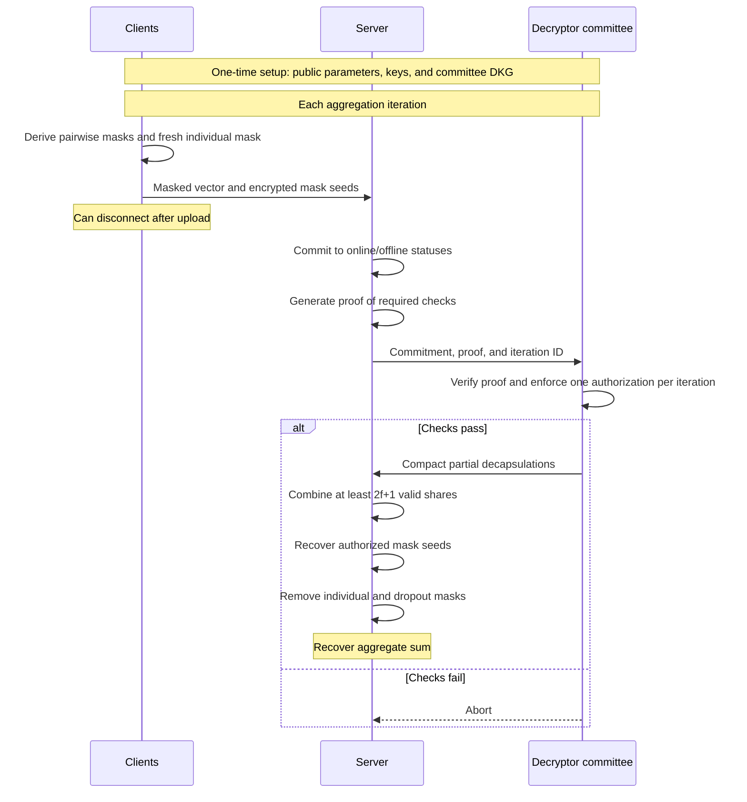

---
# Summary
## 1. Problem

Each client holds a private vector $x_i \in \mathbb{F}^{\ell}$. The server should learn only the aggregate:

$$
s = \sum_{i \in U} x_i,
$$

where $U$ is the accepted set of contributing clients.

A small **committee of decryptors** helps the server recover the sum while protecting individual inputs. Previous protocols can place substantial computation and communication costs on this committee.

## 2. Main Contribution

In the base protocol, Lighthouse achieves:

- $O(1)$ **computation** per committee member.
- $O(1)$ server–committee **communication** regarding client count $n$ and vector dimension $\ell$, holding committee size and security parameters fixed.
- One message per ordinary client per aggregation, after which the client can disconnect.
- Two round trips per aggregation, excluding setup.

These constant-cost claims concern committee overhead, not total system computation or communication.

## 3. Main Techniques

- **Pairwise masking:** Masks shared between contributing clients cancel when their masked vectors are summed.
- **Batched threshold encryption:** The committee authorizes many mask decryptions through compact responses.
- **Succinct proofs:** The server proves that its committed participation set satisfies the required checks.
- **One-of-two decryption:** For each client, the server can recover either the individual mask or the relevant pairwise masks, according to the committed status, but not both.

## 4. Threat Model and Assumptions

- A malicious adversary with static corruption.
- The server, some clients, and some committee members may be corrupted.
- Client corruption and dropout fractions satisfy:

$$
\eta + \delta < \frac{1}{3}.
$$

- Committee corruption and dropout fractions satisfy:

$$
\eta_D + \delta_D < \frac{1}{3}.
$$

- Authenticated communication, a verifiable PKI, and public randomness.
- A one-time distributed key generation procedure for the committee.

## 5. Important Qualifications

- **Single-server still involves an auxiliary committee.**
- Security permits abort; guaranteed output delivery is not provided.
- Malicious-input validation and poisoning resistance are outside scope.
- The dynamic-participation extension introduces committee computation depending on newly joined clients and communication depending on vector dimension.
- Lower committee overhead comes with additional server work. Table 3 reports higher server computation than Flamingo.

## 6. Evaluation Setup

- 64–1024 clients.
- 16K-dimensional input vectors with 32-bit entries.
- 60 decryptors.
- 10% dropout rate.
- Direct experimental comparison with Flamingo.
- Python protocol logic with Rust cryptographic components.

---
# Main Scheme 
## Static-Participation Lighthouse
Based on §4.1–4.2. These notes describe the base protocol; dynamic participation is a separate extension.

### 1. Notation

| Symbol | Meaning |
| --- | --- |
| $t$ | Aggregation iteration |
| $n$ | Number of clients selected for this iteration |
| $x_{i,t} \in \mathbb{F}^{\ell}$ | Client $i$'s private input vector |
| $G_t$ | Public logical graph for pairwise masking |
| $N_t(i)$ | Neighbors of client $i$ in $G_t$ |
| $U_t$ | Clients labeled online in the authorized aggregation |
| $O_t = [n] \setminus U_t$ | Clients labeled offline |
| $r_{i,j}$ | Long-term Diffie–Hellman secret shared by clients $i,j$ |
| $h_{i,j,t}$ | Pairwise seed derived for iteration $t$ |
| $m_{i,t}$ | Fresh individual mask seed |
| $L = 3f+1$ | Number of committee members |

All vector additions and subtractions take place in $\mathbb{F}^{\ell}$.

The logical graph describes shared masks. It does not require direct network connections between clients: communication is routed through the server.

### 2. One-Time Setup

The system establishes:

1. A verifiable PKI for authenticated client public keys.
2. Public randomness for client selection and graph generation.
3. Public parameters for TB-IB-KEM and the SNARK.
4. A decryptor committee holding shares of a secret key.

The committee runs distributed key generation to obtain:

$$
pk,\quad sk_1,\ldots,sk_L.
$$

The server needs $2f+1$ valid partial decapsulations for the same commitment and iteration.

Setup is amortized across multiple aggregation iterations.

### 3. Pairwise and Individual Masks

#### Pairwise masks

Each neighboring pair derives an iteration-specific seed:

$$
h_{i,j,t} = \operatorname{PRF}(r_{i,j},t).
$$

Both clients derive the same vector:

$$
p_{i,j,t} = \operatorname{PRG}(h_{i,j,t})
          = p_{j,i,t}.
$$

The smaller-index client adds this vector, and the larger-index client subtracts it.

Define:

$$
\epsilon_{i,j} =
\begin{cases}
+1, & i<j,\\
-1, & i>j.
\end{cases}
$$

Therefore:

$$
\epsilon_{i,j}p_{i,j,t}
+
\epsilon_{j,i}p_{j,i,t}
= 0.
$$

#### Individual mask

Client $i$ also samples a fresh seed:

$$
m_{i,t} \leftarrow \{0,1\}^{\lambda},
$$

and expands it into a vector:

$$
a_{i,t} = \operatorname{PRG}(m_{i,t}).
$$

Its masked input is:

$$
y_{i,t}
=
x_{i,t}
+
a_{i,t}
+
\sum_{j \in N_t(i)}
\epsilon_{i,j}p_{i,j,t}.
$$

The individual mask protects the input when the client is labeled offline and the server obtains pairwise seeds associated with that label.

### 4. Why Dropouts Leave Residual Masks

When both endpoints of an edge contribute, their pairwise masks cancel.

When only one endpoint contributes, only one signed copy appears in the sum.

Thus:

$$
\sum_{i \in U_t} y_{i,t}
=
\sum_{i \in U_t} x_{i,t}
+
\sum_{i \in U_t} a_{i,t}
+
\sum_{i \in U_t}
\sum_{j \in N_t(i)\cap O_t}
\epsilon_{i,j}p_{i,j,t}.
$$

The last term contains the residual masks on edges between online and offline clients.

The server needs to remove:

- Individual masks of online clients.
- Residual pairwise masks involving offline neighbors.

#### Example: Three Clients

For illustration, suppose all three clients are neighbors. Omit the iteration index:

$$
\begin{aligned}
y_1 &= x_1+a_1+p_{12}+p_{13},\\
y_2 &= x_2+a_2-p_{12}+p_{23},\\
y_3 &= x_3+a_3-p_{13}-p_{23}.
\end{aligned}
$$

If all contribute:

$$
y_1+y_2+y_3
=
x_1+x_2+x_3+a_1+a_2+a_3.
$$

If client $3$ drops out:

$$
y_1+y_2
=
x_1+x_2+a_1+a_2+p_{13}+p_{23}.
$$

Recovering $x_1+x_2$ requires removing $a_1,a_2,p_{13},p_{23}$.

The server should not obtain $p_{12}$: it remains a mask between the two contributing clients.

This example illustrates cancellation only; it does not instantiate the paper's security parameters.

### 5. Report Phase: What Each Client Sends

Lighthouse uses a threshold batched identity-based key encapsulation mechanism, abbreviated TB-IB-KEM.

The iteration $t$ is the epoch identifier. For each client index, there are two identity labels:

- $i\|1$: client $i$ is online.
- $i\|0$: client $i$ is offline.

#### Protecting the individual seed

Client $i$ encapsulates a key under its own online identity:

$$
(k_i^{(1)},ct_i^{(1)})
\leftarrow
\operatorname{Encap}(pk,t,i\|1).
$$

It protects its individual seed using:

$$
\widehat{ct}_i^{(1)}
=
H(k_i^{(1)})\oplus m_{i,t}.
$$

#### Protecting pairwise seeds

For every neighbor $j$, client $i$ encapsulates a key under the neighbor's offline identity:

$$
(k_{i,j}^{(0)},ct_{i,j}^{(0)})
\leftarrow
\operatorname{Encap}(pk,t,j\|0).
$$

It protects the shared seed using:

$$
\widehat{ct}_{i,j}^{(0)}
=
H(k_{i,j}^{(0)})\oplus h_{i,j,t}.
$$

**Important indexing:** The pairwise ciphertext uploaded by $i$ is tagged with $j\|0$, not $i\|0$.

Therefore, if $j$ drops out, the server can recover the required seed from surviving neighbor $i$'s upload.

#### Complete upload

Client $i$ sends:

$$
\left(
y_{i,t},
ct_i^{(1)},
\widehat{ct}_i^{(1)},
\left\{
ct_{i,j}^{(0)},
\widehat{ct}_{i,j}^{(0)}
\right\}_{j\in N_t(i)}
\right).
$$

The ordinary client can then go offline.

### 6. Cross-Check: Authorizing One Participation Set

The server constructs a status vector:

$$
b=(b_1,\ldots,b_n),
\qquad
b_i=
\begin{cases}
1, & i\in U_t,\\
0, & i\in O_t.
\end{cases}
$$

An honest server labels clients according to received uploads. Security must also handle malicious labeling.

The server computes a KZG vector commitment:

$$
cm=\operatorname{Commit}(b),
$$

and a SNARK proof $\pi$ about the committed vector.

The main protocol description requires:

1. Every $b_i$ is a bit.
2. At least $(1-\delta)n$ clients are online.
3. The online clients form a connected subgraph.
4. Every online client has sufficiently many online neighbors.

The neighbor condition reduces the probability that an honest online client's online neighbors are all corrupted.

The server sends $(cm,\pi)$ to each committee member.

Each member verifies the proof. If verification fails, it aborts. Otherwise, it returns:

$$
pd_k
=
\operatorname{BatchPartDec}(sk_k,cm,t).
$$

The committee authorizes the committed set without receiving every mask ciphertext or the full status vector.

### 7. One-of-Two Decryption

The commitment fixes one bit per client index.

| Authorized status | Recoverable material |
| --- | --- |
| $b_i=1$ | Client $i$'s individual seed $m_{i,t}$ |
| $b_i=0$ | Pairwise seeds encrypted under $i\|0$ by its neighbors |

For a single authorized commitment and epoch, one-of-two security prevents recovery of both identity branches for the same index.

This restriction alone is insufficient: the graph checks are also needed to stop the server from labeling all honest neighbors of a target offline.

#### Preventing inconsistent authorizations

Honest committee members authorize at most one commitment per iteration.

Two quorums of size $2f+1$ among $3f+1$ members intersect in at least $f+1$ members. With at most $f$ malicious members, their intersection contains an honest member.

Consequently, the server cannot obtain authorization for two conflicting commitments without an honest member authorizing twice.

#### Preventing cross-iteration reuse

Encapsulations and partial decapsulations are bound to $t$.

Authorization for one iteration cannot be reused to decrypt ciphertexts from another. Pairwise seeds also change through the PRF, and individual seeds are freshly sampled.

### 8. Reconstruction

After collecting enough valid partial decapsulations, the server combines them and computes KZG opening proofs for the committed status vector.

It then:

1. Recovers $m_{i,t}$ for each online client $i$.
2. Recovers $h_{i,j,t}$ for each online–offline edge.
3. Expands these seeds with the PRG.
4. Removes the corresponding masks.

The final result is:

$$
s_t
=
\sum_{i\in U_t}
\left(
y_{i,t}
-
\operatorname{PRG}(m_{i,t})
-
\sum_{j\in N_t(i)\cap O_t}
\epsilon_{i,j}\operatorname{PRG}(h_{i,j,t})
\right)
=
\sum_{i\in U_t}x_{i,t}.
$$

The pairwise masks between online clients cancel automatically.

### 9. Where the Constant Committee Cost Comes From

The server performs the work that scales with the aggregation:

- Processing client uploads.
- Constructing the commitment and SNARK proof.
- Computing KZG opening proofs.
- Decapsulating the authorized keys.
- Expanding and removing masks.

Each committee member instead verifies a succinct proof and returns a compact partial decapsulation.

For fixed security parameters and committee size, the intended per-iteration committee overhead is $O(1)$ with respect to $n$ and $\ell$.

This does not make the full aggregation constant-cost: uploading and processing $n$ vectors alone requires $\Omega(n\ell)$ field elements.

### 10. Details to Revisit During Proof Reading

#### Stronger condition in Theorem 3

The threat-model discussion states:

$$
\delta_D+\eta_D<\frac{1}{3}.
$$

However, Theorem 3 explicitly assumes:

$$
2\delta_D+\eta_D<\frac{1}{3}.
$$

Our earlier summary gave only the threat-model condition. Use the stronger condition when describing the theorem's stated guarantee.

#### Connectivity versus Appendix C

Section 4.2 explicitly lists connectivity of online clients as a required check.

Appendix C's displayed relation lists commitment consistency, binary statuses, a minimum online population, and minimum online degree. It does not explicitly include a global connectivity constraint.

A minimum-degree condition alone does not generally imply connectivity. We should check how the graph construction and security proof address this difference.

#### Typographical issue in the neighbor condition

Section 4.2 prints $\eta^\chi<2^\kappa$. The surrounding security discussion indicates an intended negligible bound involving $2^{-\kappa}$.

Treat the printed inequality as a likely typo and verify it against the proof.

**Sources:** §3, §4.1–4.5, Theorem 3, and Appendix C.

## Protocol

### How It Works

1. **Mask and upload:** Each client adds an individual mask and signed pairwise masks to its input. It uploads the masked vector and encrypted seeds.
2. **Authorize:** The server commits to an online/offline status vector and proves the required checks. Committee members verify it and return compact decryption shares.
3. **Unmask the sum:** With enough shares, the server recovers online clients' individual masks and residual masks involving offline clients. Masks between online clients cancel automatically.

**Privacy mechanism:** For each client index, the authorization permits either the online or offline decryption branch. Together with the graph checks, this protects individual inputs while allowing aggregation.

**Source:** §4.2; static-participation base protocol.

---
# Questions

---
# Related Topics
- [[]]