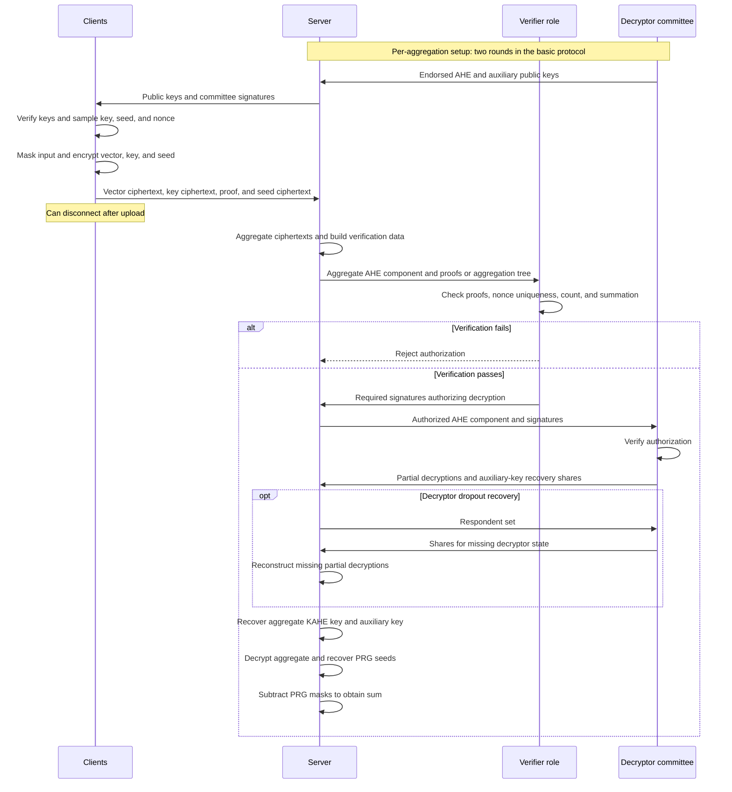

---
# Summary

## 1. Problem

A server wants to compute the sum of clients' private vectors:

$$
s=\sum_{i\in S}x_i,
\qquad
x_i\in\mathbb{F}^{\ell},
$$

without learning information beyond the permitted aggregate.

Many secure aggregation protocols require clients to synchronize or remain online across several rounds. This is problematic when clients arrive gradually or have unreliable connections.

Willow targets:

- **One-shot clients:** Each client uploads one contribution and can disconnect.
- **Dynamic participation:** Clients can contribute without knowing who else will participate.
- **Lightweight helpers:** Verification and decryption should not require processing the full input vectors.

## 2. Main Contribution

Willow reduces aggregation of long vectors to protected aggregation of short encryption keys.

Its main contributions are:

1. A single-server aggregation protocol supporting one-shot clients and dynamic participation.
2. Helper computation and communication independent of vector dimension $\ell$.
3. Distributed verification that can give sublinear work per helper when the verifier population grows appropriately with client count.
4. An efficient RLWE-based encryption scheme secure even when the sum of its secret keys is revealed.
5. Variants providing stronger correctness and guaranteed output delivery.
6. A lower-bound argument motivating the random-oracle model for this combination of functionality and low post-upload communication.

**Important scaling distinction:** Decryptor work and verifier work are different. With a fixed number of verifiers, each verifier's workload still grows linearly with $n$.

Sources: §1.1, §4, §6, Appendix F.

## 3. Main Techniques

| Technique | Role |
| --- | --- |
| Key- and message-additive homomorphic encryption, KAHE | Aggregates vectors encrypted under different client keys |
| Threshold additive homomorphic encryption, AHE | Protects and aggregates the short KAHE keys |
| Leakage-resilient KAHE security | Allows revealing the aggregate key without revealing individual plaintexts |
| Zero-knowledge proofs of knowledge | Prevents malformed or correlated encryption components and rogue public keys |
| Nonces bound into proofs | Enables detection of repeated contributions |
| Aggregation tree | Distributes verification of proofs, uniqueness, and ciphertext summation |
| PRG masks with separately encrypted seeds | Supports the simulation proof and controlled release of the output |
| Secret sharing of decryptor state | Supports recovery when committee members drop out |
| Noise flooding | Protects secret-key shares exposed through partial decryptions |

**Difference from Lighthouse:** Willow uses encrypted vector aggregation and encrypted key aggregation. It does not use cancellation of pairwise masks between ordinary clients.

## 4. Threat Model and Assumptions

### Parties

- **Clients:** Supply private input vectors.
- **Server:** Collects contributions, performs aggregation, and receives the result.
- **Decryptor role:** Generates public keys and assists with decryption.
- **Verifier role:** Checks the server's aggregation before authorizing decryption.

The decryptor and verifier roles can be implemented by committees. They may also be performed by the same helper parties.

### Adversary

The paper considers a **static adversary** that may maliciously corrupt:

- The server.
- Any number of ordinary clients.
- A bounded number of decryptors.
- A bounded fraction of verifiers under the chosen distributed-verification construction.

For the basic malicious-server protocol, Theorem 2 states the decryptor corruption bound:

$$
c_D\leq 2t-m-1,
$$

where $m$ is the number of decryptors and $t$ is the secret-sharing threshold.

The protocol also requires enough surviving decryptors to meet its reconstruction checks. The corruption and dropout parameters must be chosen jointly.

### Infrastructure and cryptography

- A PKI for decryptors and verifiers.
- Authenticated, confidential helper-to-helper communication relayed through the server.
- No PKI between ordinary contributing clients.
- RLWE-based encryption, with Hint-RLWE analysis for KAHE leakage resilience.
- Digital signatures and zero-knowledge proofs.
- A programmable random oracle modeling PRG expansion in the security proof.

Sources: §2, §5–6, Appendices A–E.

## 5. Important Qualifications

### Privacy and correctness are separate guarantees

The basic protocol protects client privacy against a malicious server.

It does **not** provide meaningful output-correctness guarantees to an honest or passively corrupted server when some decryptors behave maliciously.

Stronger variants add verification of partial decryptions and secret sharing.

### The server can exclude contributions

A malicious server may choose which contributions to include, subject to the minimum aggregation size:

$$
|S|\geq \mathrm{min\_n}.
$$

An ordinary client communicates only with the server, so other parties cannot distinguish a missing contribution from one the server deliberately ignores.

### Unique nonces do not establish unique people or devices

The verifier checks that contributions have distinct proof-bound nonces.

This prevents replay of the same contribution, but does not prevent an attacker from creating many fresh contributions.

### Aggregation alone does not prevent Sybil inference

If the adversary knows every input except one, it can subtract those known inputs from the aggregate and recover the remaining input.

The guarantee is privacy beyond the permitted aggregate, not protection against information already implied by that aggregate.

### Input validation is outside the main construction

The proofs used for encryption do not establish that a client's vector represents a valid model update, bounded histogram, or otherwise legitimate application input.

### Verification has different security variants

- Committee-based verification targets negligible cheating probability.
- Random spot-checking provides a tunable probability of detecting cheating.

These are different guarantees.

### Public-key reuse is not established by the main protocol

The paper assumes the decryptor public keys are tied to one aggregation.

Reusing them across aggregations is discussed as a conjectured extension requiring aggregation identifiers and appropriate replay protection.

### Guaranteed output delivery is conditional

The stronger variant targets delivery to an honest or semi-honest server under suitable helper corruption and availability bounds.

A malicious server can still refuse to participate.

Sources: §2.3, §3, §6.4–6.7, Appendices H–I.

## 6. Evaluation Setup

| Item | Setting |
| --- | --- |
| Implementation | C++ and Rust |
| Encryption library | SHELL |
| Proof framework | Bulletproofs with additional range-proof support |
| Machine | Google Cloud `n2-standard-48` |
| Processor | Intel Ice Lake with AVX512 |
| Memory | 192 GB |
| Computational security target | At least 128 bits |
| Flooding-noise statistical security | 40 bits |
| Parameter sets | $n\in\{10^3,10^5,10^7\}$ and $\ell\in\{10^3,10^5,10^7\}$ |
| Typical decryptor population | 100 |
| Main comparisons | Flamingo and LERNA |

The large parameter sets and scaling analyses should not be interpreted as evidence of a live deployment with millions of devices.

### Representative microbenchmark

Table 3 uses $n=1000$. For $\ell=10^5$, it reports:

| Operation | Reported cost |
| --- | --- |
| Client proof generation | $<829$ ms |
| Client encryption | $8.2$ ms |
| Client upload | Approximately $427$ KB |
| Server homomorphic aggregation per client | $0.0522$ ms |
| Server proof verification per client | $<227$ ms |
| Verifier proof verification per client | $<227$ ms |

Proof generation and verification dominate the arithmetic cost.

The data-independent proof work can be prepared before the input vector becomes available, but it remains part of the total computational cost.

The comparison with prior work reports substantially higher server computation per client for Willow, in exchange for dynamic participation and its helper-scaling properties.

Sources: §7, Tables 2–3, Figures 7–8.

---

# Main Scheme

## Willow: Encrypted Vector Aggregation with Verified Key Recovery

### 1. Notation

| Symbol                                | Meaning                                      |
| ------------------------------------- | -------------------------------------------- |
| $x_i\in\mathbb{F}^{\ell}$             | Client $i$'s input                           |
| $S$                                   | Set of included contributions                |
| $k_i$                                 | Fresh symmetric KAHE key                     |
| $z_i$                                 | Fresh PRG seed                               |
| $r_i=\operatorname{PRG}(z_i,\ell)$    | Expanded mask vector                         |
| $y_i=x_i+r_i$                         | Masked input                                 |
| $M_i$                                 | KAHE encryption of $y_i$                     |
| $B_i=(B_{i,0},B_{i,1})$               | AHE encryption of $k_i$                      |
| $C_i$                                 | Auxiliary encryption of $z_i$                |
| $\tau_i$                              | Random nonce bound into the encryption proof |
| $\pi_i$                               | Client encryption proof                      |
| $pk,sk$                               | Threshold AHE public and secret key          |
| $pk_{\mathrm{aux}},sk_{\mathrm{aux}}$ | Auxiliary encryption keys for PRG seeds      |
| $m$                                   | Number of decryptors                         |
| $t$                                   | Secret-sharing reconstruction threshold      |
| $c_V$                                 | Number of verifiers                          |

The notation here is slightly renamed for clarity while preserving the paper's construction.

### 2. Two Homomorphic Encryption Layers

#### KAHE: Aggregate both keys and messages

The symmetric scheme supports:

$$
\operatorname{Dec}_{k_1+k_2}
\left(
\operatorname{Enc}_{k_1}(y_1)
+
\operatorname{Enc}_{k_2}(y_2)
\right)
=
y_1+y_2.
$$

Consequently:

$$
\operatorname{Dec}_{\sum_{i\in S}k_i}
\left(
\sum_{i\in S}M_i
\right)
=
\sum_{i\in S}y_i.
$$

This lets clients encrypt independently under fresh keys.

#### AHE: Aggregate the short keys

Clients encrypt their KAHE keys under a common public key:

$$
B_i=\operatorname{AHE.Enc}(pk,k_i).
$$

The server computes:

$$
B=\sum_{i\in S}B_i.
$$

Threshold decryption yields:

$$
K=\sum_{i\in S}k_i.
$$

The helpers therefore handle encryption keys rather than the long input vectors.

#### Why ordinary encryption security is insufficient

The server receives both individual KAHE ciphertexts and $K$.

KAHE must remain secure under this aggregate-key leakage. Its security notion requires that this view reveal only the permitted sum of plaintexts.

Source: §5.1, Definition 5 and Lemma 1 in Appendix B.

### 3. Concrete RLWE-Based KAHE

For one polynomial block, define:

$$
R_{q_1}
=
\mathbb{Z}_{q_1}[X]/(X^{N_1}+1).
$$

Let $a\in R_{q_1}$ be public. Encryption takes the form:

$$
M_i
=
a k_i+t_1e_i+y_i
\pmod{q_1},
$$

where $k_i$ and $e_i$ have small Gaussian coefficients.

Summing gives:

$$
M
=
aK+t_1\sum_{i\in S}e_i
+
\sum_{i\in S}y_i
\pmod{q_1}.
$$

With parameters ensuring correct decoding, subtracting $aK$ and reducing modulo $t_1$ recovers the plaintext sum.

Long vectors are encoded into polynomial blocks. Packing and modulus selection must accommodate the aggregate and accumulated noise.

Source: §5.1, Appendix B.

### 4. Setup and Decryptor State

The decryptors generate shares of two key pairs:

$$
(pk,sk)
\quad\text{and}\quad
(pk_{\mathrm{aux}},sk_{\mathrm{aux}}).
$$

For the AHE scheme, the global secret key is additively distributed:

$$
sk=\sum_{j\in D}sk_j.
$$

Each decryptor proves that its public-key contribution was correctly generated. This prevents rogue-key attacks in which a malicious participant tries to cancel honest public-key contributions.

To support dropouts, decryptors also distribute threshold shares of the randomness used to generate their local keys.

The server collects signatures endorsing the resulting public keys. Clients check the required signatures before using those keys.

**Base-protocol cost:** Two setup rounds for decryptors.

Source: §6.2, Figure 3.

### 5. Client Contribution

Each client independently performs the following steps.

#### Step A: Verify the public keys

Receive the committee-endorsed key material and verify the required signatures.

#### Step B: Sample a key and mask

$$
k_i\leftarrow\operatorname{KAHE.KeyGen},
\qquad
z_i\leftarrow\{0,1\}^{\lambda}.
$$

Compute:

$$
r_i=\operatorname{PRG}(z_i,\ell),
\qquad
y_i=x_i+r_i.
$$

#### Step C: Encrypt the masked vector

$$
M_i=\operatorname{KAHE.Enc}(y_i,k_i).
$$

#### Step D: Encrypt the KAHE key with a proof

Choose a random nonce $\tau_i$ and compute:

$$
(B_i,\pi_i)
\leftarrow
\operatorname{AHE.VerifiableEnc}(pk,k_i;\tau_i).
$$

In the concrete construction, the proof concerns knowledge of bounded encryption randomness and error associated with component $B_{i,1}$.

It is not a proof that the application input $x_i$ is valid.

#### Step E: Encrypt the PRG seed

$$
C_i=\operatorname{E.Enc}(pk_{\mathrm{aux}},z_i).
$$

#### Step F: Upload once

Send:

$$
(M_i,B_i,\pi_i,C_i).
$$

The client can then disconnect.

There are no pairwise client masks, neighbor discovery, or later ordinary-client recovery messages.

Source: §6.3, Figure 5.

### 6. Server Aggregation

For the selected contributions $S$, the server computes:

$$
M=\sum_{i\in S}M_i,
\qquad
B=\sum_{i\in S}B_i.
$$

It retains the seed ciphertexts:

$$
\{C_i\}_{i\in S},
$$

and the client proofs.

The server must obtain verifier authorization before decryptors assist with the aggregated AHE ciphertext.

Source: Figure 4.

### 7. Verification and the Aggregation Tree

#### What the verifier checks

The centralized verifier checks:

1. At least $\mathrm{min\_n}$ contributions are included.
2. All required encryption proofs verify.
3. Their proof-bound nonces are distinct.
4. Their associated ciphertext components sum to the component presented for decryption.

In particular:

$$
B_1=\sum_{i\in S}B_{i,1}.
$$

If the checks pass, the verifier signs the authorized ciphertext component.

**Scope:** This authorizes the AHE decryption component. It is not a blanket proof of correctness for every uploaded payload.

#### Why the nonce matters

The nonce is included in the proof statement and Fiat–Shamir transcript.

The server cannot simply replay one proof several times under different nonce labels.

Distinct nonces still do not prevent one adversary from generating many fresh submissions.

#### Distributed verification

The server constructs an aggregation tree:

- Leaves contain proofs and commitments to ciphertext components.
- Leaves are sorted by nonce.
- Internal commitments combine their children's committed values additively.
- The root commits to the aggregate ciphertext component.

The verifier's work can be divided among committees assigned contiguous leaf intervals.

Each assigned committee verifies its portion and endorses the common root. Decryptors require the specified endorsements from every interval.

If there are $c_V$ verifiers grouped into committees of size $g$, Theorem 2 states per-verifier cost:

$$
O\left(\frac{ng}{c_V}+\log n\right).
$$

A separate spot-checking variant offers probabilistic detection rather than negligible cheating probability.

Source: §6.4, Figure 6.

### 8. Authorized Decryption and Output Recovery

#### Recover the aggregate key

After checking verifier authorization, decryptor $j$ computes a partial decryption.

For the concrete AHE construction:

$$
pd_j=B_1sk_j+e_{\mathrm{flood},j}.
$$

Flooding noise hides secret-dependent information in the partial decryption.

The server combines the partial decryptions with $B_0$ to recover:

$$
K=\sum_{i\in S}k_i.
$$

The global AHE secret key $sk$ is not released.

#### Recover the PRG seeds

The protocol also reconstructs the auxiliary secret key:

$$
sk_{\mathrm{aux}}.
$$

The server can then decrypt the retained seed ciphertexts:

$$
z_i=\operatorname{E.Dec}(sk_{\mathrm{aux}},C_i).
$$

Unlike the AHE key, this auxiliary key is intentionally released during the final phase.

#### Compute the result

First:

$$
Y=\operatorname{KAHE.Dec}(M,K)
=
\sum_{i\in S}(x_i+r_i).
$$

Then:

$$
s
=
Y-\sum_{i\in S}\operatorname{PRG}(z_i,\ell)
=
\sum_{i\in S}x_i.
$$

These equations describe correct execution with well-formed messages. Guarantees against malicious decryptor manipulation depend on the selected protocol variant.

#### Handling decryptor dropouts

The basic protocol uses:

1. A round collecting partial decryptions and auxiliary-key recovery shares.
2. A dropout-recovery round collecting shares needed to reconstruct missing decryptor state.

If no decryptors drop out, the second decryption round can be omitted in the basic protocol.

Ordinary clients do not return for dropout recovery.

Sources: §6.2–6.3, Figures 3–5.

### 9. Why the Extra PRG Mask Is Needed

The introductory blueprint shows vector encryption and key encryption. The full protocol additionally masks each vector and separately encrypts the mask seed.

This extra layer supports two purposes.

#### Simulation security

The simulator initially produces contributions without knowing the honest inputs.

After observing the authorized aggregation set, it learns the permitted sum from the ideal functionality and programs the random oracle so the simulated execution produces that sum.

The seeds remain hidden until the relevant release phase.

This is a proof technique; real participants do not program a random oracle.

#### Preventing selective aborts in the stronger variant

The correctness variant delays release of the auxiliary key until after the relevant partial-decryption decisions.

This prevents malicious decryptors from first learning the result and then choosing whether the honest server should receive it.

Sources: §4, §6.3, §6.6, Appendices F–H.

### 10. Security Mechanisms and Protocol Variants

#### Correlated-ciphertext attack

Without the required proof, a malicious client could submit a key ciphertext related to honest clients' ciphertexts.

For example, the attack described in §4 uses:

$$
B_{\mathrm{bad}}
=
-\sum_{i=1}^{n-2}B_i.
$$

After including a final honest client, the aggregate key could become that client's individual key.

The proof of knowledge of the required encryption randomness prevents the attacker from freely constructing such correlated submissions.

#### Three main variants

| Variant | Additional mechanism | Guarantee emphasized |
| --- | --- | --- |
| Basic protocol | Verifiable key generation, client proofs, verifier authorization | Privacy against a malicious server |
| Correctness with abort | Verifiable partial decryptions, VSS, and delayed auxiliary-key release | Correct output or non-selective abort for an honest or semi-honest server |
| Guaranteed output delivery | Verify sharing consistency during setup and share actual keys rather than only their generating seeds | Output delivery under the stated corruption and availability assumptions |

The guaranteed-output variant increases decryptor setup from two to three rounds and adds communication.

The differential-privacy extension in Appendix I is separate. Having committee members contribute noise introduces vector-length-dependent communication for those members.

### 11. Details to Revisit Before Implementation

#### Corruption and dropout formulas

Theorem 2 gives:

$$
c_D\leq 2t-m-1.
$$

Figure 3 requires at least $t$ decryption respondents, corresponding to at most $m-t$ missing respondents in that check.

Some surrounding prose gives inconsistent dropout expressions. Appendix H.2 also states a joint constraint:

$$
d\leq m-t-c_D,
$$

while Theorems 3–4 print a corruption bound involving $t+d-m$, which appears inconsistent with that discussion.

These expressions should be reconciled before choosing implementation parameters. Do not replace them with a generic honest-majority assumption.

#### Benchmark reporting

Table 3 reports proof verification below $227$ ms, while nearby prose mentions $327$ ms. The representative figures above follow Table 3.

#### Scope of the lower bound

Appendix F argues against standard-model white-box—and therefore black-box—simulation proofs under its stated conditions, including sufficiently many possible included subsets and sublinear post-selection communication.

This is more specific than saying all one-shot secure aggregation is impossible without random oracles.

## Protocol

### How It Works

1. **Encrypt:** Each client masks its input, encrypts the masked vector, encrypts its short key and mask seed, and uploads once.
2. **Verify:** Verifiers check that the authorized key aggregation contains valid, non-replayed contributions.
3. **Decrypt:** The committee assists with recovery of the aggregate key and auxiliary seed-decryption key.
4. **Recover:** The server decrypts the aggregate vector and subtracts the PRG masks.

The diagram follows the basic protocol in Figures 3–6. The correctness variant changes partial-decryption verification and the timing of auxiliary-key release.

**Core idea:** Helpers authorize and decrypt short key material; the server performs the work on long vectors.

---
# Questions

---
# Related Topics
- [[]]