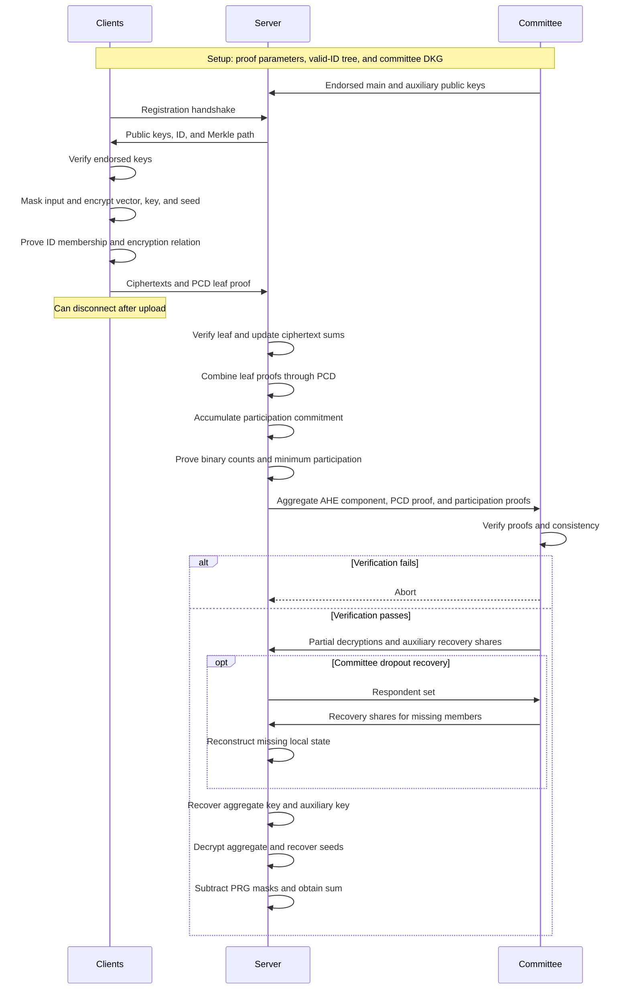

# Summary

## 1. Problem

A server wants to recover an aggregate:

$$
s=\sum_{i\in S}x_i,
\qquad
x_i\in\mathbb{F}^{\ell},
$$

while protecting individual inputs beyond what the aggregate reveals.

Willow already supports one-shot clients and dynamic participation. However, its verifier role must check all included client proofs, giving linear total verification work in the number of contributions.

Distributing this work reduces the burden per verifier but requires more helper parties.

**WillowFold's goal:** Keep the helper committee small and make its verification work succinct, while moving the expensive proof computation to the server.

Sources: §1, §3.1.

## 2. Main Contribution

WillowFold replaces Willow's explicit verification of all client contributions with a recursively accumulated proof.

The main contributions are:

1. **Lightweight committee verification:** The committee checks a succinct aggregation proof rather than every client proof.
2. **Streaming and distributed aggregation:** The server can combine contributions and their proofs incrementally.
3. **Succinct replay prevention:** Committed participation counts are proven to be binary, preventing duplicate IDs.
4. **Stronger security formalization:** The paper identifies simulation extractability as necessary for its treatment of correlated-ciphertext attacks.
5. **A concrete proof-system construction:** A zero-knowledge, simulation-extractable variant of Spartan+KZH, used within leaf-decoupled PCD.

The paper reports the following asymptotic costs, suppressing security-parameter dependencies:

| Role | Reported cost |
| --- | --- |
| Client | $O(\ell+\log n)$ |
| Server | $O(n(\ell+\log n))$ |
| Committee member | $O(m+\log n)$ |

Here $m$ is the committee size. For fixed $m$, committee cost is logarithmic in the population parameter.

The predefined ID capacity is denoted $N$ in the construction. Merkle paths and participation proofs depend on this capacity; distinguish it from the number of actual contributions.

Sources: §1.1, Table 1, §5.

## 3. Main Techniques

| Technique | Purpose |
| --- | --- |
| KAHE | Aggregate vectors encrypted under different symmetric keys |
| Threshold AHE | Recover the sum of those symmetric keys |
| PRG masking and encrypted seeds | Support simulation security and controlled output release |
| Leaf-decoupled proof-carrying data, PCD | Recursively combine client proofs and ciphertext sums |
| Homomorphic polynomial commitments | Compactly represent participation counts |
| Merkle membership proofs | Certify that client IDs belong to the predefined valid-ID set |
| Zerocheck | Prove that every participation count is either zero or one |
| Sumcheck | Prove that the aggregation includes enough contributions |
| Leaf simulation extractability | Support extraction despite access to simulated client proofs |
| Commit-and-prove and probabilistic checks | Reduce the circuit cost of non-native ring arithmetic |

**Relationship to Willow:** The encryption structure is inherited. The main changes concern verification, replay prevention, and the proof system.

**Relationship to Lighthouse:** WillowFold does not use ordinary-client pairwise-mask cancellation.

## 4. Threat Model and Assumptions

### Parties

- **Clients:** Supply private vectors.
- **Server:** Collects contributions, aggregates ciphertexts, generates proofs, and receives the sum.
- **Committee:** Generates threshold keys, verifies the final proofs, and assists with decryption.

There is no separate verifier role in the main WillowFold construction. Decryptors perform the succinct verification themselves.

### Adversary

Theorem 5 considers a **static active adversary** corrupting:

- The server.
- Any number of ordinary clients.
- A bounded number of committee members.

Using $m$ for committee size, its stated corruption bound is:

$$
c_D\leq 2t-m-1,
$$

where $t$ is the reconstruction threshold.

Enough committee members must also remain available. An informal honest-majority description does not replace the joint threshold and availability requirements.

### Infrastructure

- A star communication topology.
- Private client–server channels.
- A PKI for committee members.
- No PKI between ordinary clients.
- Clients obtain committee-endorsed public keys.
- An authenticated public setup, including the valid-ID Merkle root.

### Cryptographic assumptions

- Key-sum-leakage-resistant KAHE.
- Secure threshold AHE and auxiliary public-key encryption.
- Binding homomorphic polynomial commitments.
- A leaf-decoupled PCD satisfying leaf simulation extractability.
- A programmable random oracle.
- Secure signatures and hashing.
- A secure setup for the chosen proof backend.

The concrete proof backend additionally uses group-based assumptions and an algebraic-group-model analysis. Its security is not based on RLWE alone.

**Proof model:** Theorem 5 is stated in the $(\mathrm{RO},\mathrm{Setup})$-hybrid model.

Sources: §2, §5–7, Theorem 5, Appendix C.

## 5. Important Qualifications

### One-shot contribution still involves a handshake

Before uploading, a client obtains public keys, an ID, and its Merkle authentication path.

“One-shot” means one contribution upload without later participation in aggregation or recovery.

### Dynamic clients use a predefined ID capacity

The identities of participating devices need not be known in advance.

However, setup generates a valid-ID set of size $N$. Dynamic participation operates within this prepared capacity.

### Unique IDs are not Sybil resistance

The proof prevents counting the same registered ID twice.

It does not establish that different IDs belong to different people or independent devices. A minimum participant count alone does not prevent an adversary from filling the aggregate with its own contributions.

### The concrete backend requires trusted setup

The Spartan+KZH-Fold instantiation uses an updatable structured reference string, generated through a trusted setup or suitable MPC ceremony.

The valid-ID Merkle tree itself does not require secret setup randomness.

### “4 bytes per client” is a qualified storage claim

The headline refers to tracking participation IDs.

Footnote 3 states that the full simulation-secure construction also stores one encrypted PRG seed per contribution, adding **64 bytes per client**.

There are also shared public parameters, ID/Merkle data, aggregate ciphertexts, and active proving state.

Therefore, neither total server storage nor the complete protocol state is literally four bytes per client.

### Streaming does not mean constant total storage

The server can discard accumulated client proofs and large raw contributions.

It still tracks participation and retains seed ciphertexts in the full protocol.

### Correctness and output delivery require care

Figure 1 permits non-selective aborts.

The paper discusses stronger delivery guarantees through the Willow extension, but these should not be interpreted as unconditional delivery against a malicious server or arbitrary committee behavior.

Theorem 5 explicitly addresses the malicious-server case. The semi-honest discussion and the exact committee variant deserve separate attention.

### Input validation is outside scope

The client proof does not establish that the submitted vector is a legitimate model update, bounded histogram, or otherwise valid application input.

### Proof-backend limits matter

Clients store approximately **64.5 MB of proving parameters** in the implementation.

Although small relative to some proof-system alternatives, this is a material requirement for browser and mobile deployments.

Sources: §2, §5.1, Remark 1, §8.2–8.3, footnote 3.

## 6. Evaluation Setup

| Item | Setting |
| --- | --- |
| Implementation basis | Arkworks, KZH-Fold, and Willow codebases |
| PCD backend | Modified Spartan+KZH-Fold with KZH-3 |
| Curves | BN254 and Grumpkin |
| Merkle hashing | MiMC |
| Encryption parameters | Inherited from Willow |
| Server machine | Google Cloud `c4-highcpu-288` |
| Server resources | 288 vCPUs and 576 GB RAM |
| Client and committee machine | MacBook Air M3, 8-core CPU, 8 GB RAM |
| Reported server working memory | At most approximately 20 GB |
| Population sizes | $2^{10},2^{17},2^{23}$ |
| Vector lengths | $10^3,10^5,10^7$ |

### Representative results at $n=2^{23}$

| Measurement | Reported value |
| --- | --- |
| Client proof generation | Approximately $3.0$ s |
| Client encryption for $\ell=10^7$ | $296$ ms |
| Client proving parameters | $64.5$ MB |
| Server verification per client | $478$ ms |
| Server proof aggregation per client | $3.8$ s |
| Server uniqueness-proof generation | $3.2$ s |
| Committee PCD verification | $910$ ms |
| Committee uniqueness-proof verification | $104$ ms |
| Committee decryption for $\ell=10^7$ | $324$ ms |
| PCD proof size | $48$ KB |
| Uniqueness proof size | $7.6$ KB |

The paper summarizes the final proof material as approximately **57 KB** and verification as approximately **one second**.

**Timing qualification:** Table 3 gives about $1.014$ s for PCD plus uniqueness verification, before decryption. The headline should not be read as the total aggregation latency.

### Comparison reported in Table 4

| Measurement | Willow | WillowFold |
| --- | --- | --- |
| Client proof generation | $0.8$ s | $2.9$ s |
| Server work per client | $0.2$ s | $4.3$ s |
| Verifier work | $460$ hours | Approximately $1$ s |
| Verification proof material | $15$ GB | $57$ KB |

The comparison illustrates a large reduction in verification burden at the cost of roughly $22\times$ more server work per client.

These figures compare role-specific computation and proof material. They do not establish a one-second end-to-end deployment with millions of devices.

Sources: §8, Tables 2–4.

---

# Main Scheme

## WillowFold: Homomorphic Aggregation with Recursive Proofs and Committed Participation

### 1. Notation

| Symbol | Meaning |
| --- | --- |
| $N=2^h$ | Capacity of the prepared ID set |
| $S$ | Included contributions |
| $x_i$ | Client input vector |
| $k_i$ | Fresh KAHE key |
| $s_i$ | Fresh PRG seed |
| $r_i=\operatorname{PRG}(s_i,\ell)$ | Expanded input mask |
| $M_i$ | KAHE encryption of $x_i+r_i$ |
| $B_i=(B_{i,0},B_{i,1})$ | AHE encryption of $k_i$ |
| $C_i$ | Auxiliary encryption of $s_i$ |
| $g_i$ | Registered ID: commitment to a unit vector |
| $\mu_i$ | Merkle authentication path for $g_i$ |
| $\pi_i^{\mathrm{leaf}}$ | Client PCD leaf proof |
| $\mathbf{p}$ | Participation-count vector |
| $C_{\mathbf{p}}$ | Commitment to that vector |
| $\Pi_{\mathrm{PCD}}$ | Final recursive aggregation proof |
| $\Pi_{\mathrm{ID}}$ | Participation-check proof material |
| $m,t$ | Committee size and reconstruction threshold |

Notation is renamed slightly for clarity.

### 2. Inherited Encryption Structure

Each client samples $k_i,s_i$ and computes:

$$
r_i=\operatorname{PRG}(s_i,\ell),
\qquad
y_i=x_i+r_i.
$$

It creates three ciphertexts:

$$
\begin{aligned}
M_i&=\operatorname{KAHE.Enc}(y_i,k_i),\\
B_i&=\operatorname{AHE.Enc}(pk,k_i),\\
C_i&=\operatorname{E.Enc}(pk_{\mathrm{aux}},s_i).
\end{aligned}
$$

The server aggregates:

$$
M=\sum_{i\in S}M_i,
\qquad
B=\sum_{i\in S}B_i.
$$

Authorized threshold decryption of $B$ yields:

$$
K=\sum_{i\in S}k_i.
$$

Then:

$$
\operatorname{KAHE.Dec}(M,K)
=
\sum_{i\in S}(x_i+r_i).
$$

After recovering the seeds, the server subtracts the masks:

$$
s=
\operatorname{KAHE.Dec}(M,K)
-
\sum_{i\in S}\operatorname{PRG}(s_i,\ell)
=
\sum_{i\in S}x_i.
$$

**No pairwise masks:** The $r_i$ masks do not cancel automatically. The server explicitly reconstructs and subtracts them.

Sources: §4.3, Figures 4–5, Appendix E.

### 3. Setup and Registration of IDs

#### Prepare valid IDs

Let $\mathbf{e}_i$ be the length-$N$ unit vector:

$$
(\mathbf{e}_i)_j=
\begin{cases}
1,&j=i,\\
0,&j\neq i.
\end{cases}
$$

Define:

$$
g_i=\operatorname{Com}(\widetilde{\mathbf{e}}_i),
$$

where $\widetilde{\mathbf{e}}_i$ is the multilinear extension of $\mathbf{e}_i$.

These commitments are deterministic.

The server constructs a public Merkle tree over:

$$
g_0,\ldots,g_{N-1},
$$

with root $rt$.

#### Assign an ID

During registration, the client receives:

$$
(rt,g_i,\mu_i).
$$

The path $\mu_i$ authenticates $g_i$ as a member of the prepared valid-ID set.

The tree can be reused across sessions. IDs must be unique within a session.

#### Generate encryption keys

The committee runs DKG for:

$$
(pk,sk)
\quad\text{and}\quad
(pk_{\mathrm{aux}},sk_{\mathrm{aux}}).
$$

Members retain secret shares and recovery material, making the committee stateful.

The client checks the required signatures endorsing the public keys.

Source: §5.1, Figures 3 and 6.

### 4. Client Leaf Proof

The client generates a zero-knowledge proof for an instance containing:

$$
X_i=(rt,g_i,u,B_{i,1}),
$$

where $u$ is a public AHE parameter.

The proof establishes two properties.

#### Valid ID membership

$$
\operatorname{MerkleVerify}(rt,g_i,\mu_i)=1.
$$

#### Valid encryption component

The concrete circuit proves knowledge of bounded $v_i,e_{i,1}$ satisfying:

$$
B_{i,1}
=
u v_i+e_{i,1}
\pmod{q_2},
$$

with:

$$
\|v_i\|\leq B_s,
\qquad
\|e_{i,1}\|\leq B_e.
$$

The client uploads:

$$
\left(
M_i,B_i,C_i,
X_i,\pi_i^{\mathrm{leaf}}
\right),
$$

and can disconnect.

**Proof scope:** Figure 4 explicitly proves ID membership and the AHE component relation. It does not directly prove application-level input validity or correctness of every uploaded payload.

Source: Figure 4.

### 5. Recursive Aggregation by the Server

The server checks each submitted leaf proof and the consistency of its public instance with the ciphertext component.

It then updates the aggregate ciphertexts and participation state.

Using the paper's multiplicative commitment notation:

$$
\operatorname{Com}(\mathbf{a}+\mathbf{b})
=
\operatorname{Com}(\mathbf{a})
\operatorname{Com}(\mathbf{b}).
$$

For two child nodes, an internal PCD step combines:

$$
\begin{aligned}
B_1^{\mathrm{parent}}
&=
B_1^{\mathrm{left}}
+
B_1^{\mathrm{right}},\\
C_{\mathbf{p}}^{\mathrm{parent}}
&=
C_{\mathbf{p}}^{\mathrm{left}}
C_{\mathbf{p}}^{\mathrm{right}}.
\end{aligned}
$$

The resulting root instance certifies:

$$
B_1=\sum_{i\in S}B_{i,1},
$$

and:

$$
C_{\mathbf{p}}
=
\prod_{i\in S}g_i
=
\operatorname{Com}\left(\sum_{i\in S}\mathbf{e}_i\right).
$$

The root proof attests to the validity of the client leaves and the recursive aggregation steps.

**Implementation distinction:** Accumulation avoids running an expensive complete proof verifier inside every recursive circuit. The final verifier checks the resulting accumulated proof.

**Leaf decoupling:**

- Leaves prove the client relation and contain secret witnesses.
- Internal nodes combine already-proven public outputs without a new client-secret witness.

This supports parallel aggregation of independent subtrees.

Sources: §3.1–3.3, Figure 5, Appendix A.2.

### 6. Proving No Duplicate IDs

The participation vector is:

$$
\mathbf{p}=\sum_{i\in S}\mathbf{e}_i.
$$

Its coordinate $p_j$ counts how many times ID $j$ appears.

For example:

$$
\mathbf{e}_1+\mathbf{e}_3+\mathbf{e}_1
=
(0,2,0,1,\ldots).
$$

The server proves that every count is binary:

$$
p_j(1-p_j)=0
\qquad
\text{for every }j.
$$

A count of $2$ fails this check.

#### Zerocheck formulation

Let $\widetilde{p}$ be the multilinear extension of $\mathbf{p}$ over $h=\log_2N$ variables.

Define:

$$
q(\mathbf{X})
=
\widetilde{p}(\mathbf{X})
\left(1-\widetilde{p}(\mathbf{X})\right).
$$

The zerocheck proves:

$$
q(\mathbf{b})=0
\qquad
\forall\mathbf{b}\in\{0,1\}^{h}.
$$

The proof must refer to the same commitment $C_{\mathbf{p}}$ certified by the PCD root.

**Why a separate check is necessary:** Valid leaf proofs alone do not prevent the server from using the same valid leaf twice.

### 7. Proving Minimum Participation

The server also proves:

$$
\sum_{\mathbf{b}\in\{0,1\}^{h}}
\widetilde{p}(\mathbf{b})
=
s_{\mathrm{count}},
$$

and checks:

$$
s_{\mathrm{count}}\geq \mathrm{min}_t.
$$

Once the participation counts are proven binary, this sum counts distinct included IDs.

The uniqueness and minimum-count checks jointly prevent decryption of an aggregate that repeats IDs or contains too few distinct IDs.

They do not establish that the IDs represent independent real-world users.

Source: Figure 5, steps 3–4.

### 8. Committee Verification and Decryption

The server sends the committee:

- The aggregate AHE component $B_1$.
- The root PCD instance and proof.
- The participation-check instance and proofs.

Each member verifies:

1. The recursive proof.
2. The participation proofs.
3. Consistency of the proofs with each other and with $B_1$.

Members proceed only if these checks pass.

A partial decryption has the form:

$$
pd_j=B_1sk_j+e_{\mathrm{flood},j}.
$$

Flooding noise protects information about the secret-key share.

The server combines partial decryptions to recover $K$ and reconstructs the auxiliary key to recover the PRG seeds.

If members drop out, surviving members provide the specified recovery shares so the server can reconstruct missing local state.

**Key distinction:**

- The main AHE secret key remains distributed.
- The auxiliary seed-decryption key is intentionally reconstructed.

Unlike Willow, no external verifier signature is required: each decryptor checks the proofs itself.

Source: Figure 6, Appendix E.

### 9. Simulation Extractability and Correlated Ciphertexts

#### The attack being addressed

An adversarial client may try to submit ciphertexts that cancel honest contributions.

For example:

$$
B_{\mathrm{bad}}
=
-\sum_{i=1}^{n-2}B_i.
$$

After a final honest contribution arrives, the resulting aggregate can isolate its key.

The server may then recover information about that client's input.

#### Why knowledge soundness alone is insufficient

The adversary observes honest ciphertexts and their proofs.

A malleable proof system could allow it to transform those proofs into a valid proof for a related ciphertext without knowing the required witness.

The extraction guarantee must survive this access to existing or simulated proofs.

#### Leaf simulation extractability

WillowFold specializes simulation extractability to its leaf-decoupled architecture:

- The simulator answers queries for client leaf proofs.
- Internal nodes need not be zero-knowledge because they introduce no secret client witness.
- Extraction recovers the recursive transcript and witnesses for relevant non-simulated leaves.
- Simulated leaves are treated according to the simulation-query record.

This lets the aggregation simulator identify included honest contributions and program the random oracle consistently with the permitted aggregate.

**Important qualification:** The paper identifies a gap in Willow's security formalization. It also states that Willow's Bulletproofs instantiation satisfies the needed property. This is not presented as a demonstrated break of that instantiation.

Sources: §6, Theorem 4, Appendix C.2, Appendix D.

### 10. Concrete Proof Backend and Circuit Optimizations

#### Proof backend

WillowFold uses a modified Spartan+KZH-Fold:

1. Make Spartan+KZH zero-knowledge.
2. Establish simulation extractability of the resulting argument.
3. Use knowledge-sound accumulation to obtain leaf-SE PCD.

The proof of simulation extractability uses:

- Special soundness in the updatable-SRS setting.
- Trapdoor-less zero knowledge.
- Unique response.

Sources: §7, Theorems 2–3, Appendix C.

#### Low-randomness zero knowledge

The construction uses structured masking polynomials and multilinear commitments to avoid adding linear-size random witness data.

This matters because the client's witness is mostly binary. Dense random masking would remove the performance benefits of that structure.

#### Efficient ring checks

The client proof involves arithmetic over an RLWE ring whose coefficient modulus differs from the proof system's field.

The paper uses:

- Specialized range checks.
- Reduced non-native arithmetic overhead.
- Random evaluation checks for polynomial relations.
- Commit-and-prove to derive challenges after commitments are fixed.

The reported client circuit has roughly $1.4$ million constraints before padding to $2^{21}$; the server circuit has $2^{16}$ constraints.

Source: §8.1–8.3.

### 11. Points to Revisit During Deeper Review

#### Committee recovery checks

Figure 6 abbreviates the dropout-recovery procedure relative to Willow. In particular, its responder-set checks and partial-decryption verification should be reconciled with the precise variant needed for the claimed correctness and availability guarantees.

Do not silently substitute stronger Willow checks when implementing the printed algorithm.

#### Proof relation versus informal plaintext-knowledge claims

The prose describes proofs of knowledge of the encrypted KAHE key.

The concrete leaf relation in Figure 4 explicitly extracts encryption randomness and error for $B_{i,1}$.

Check how this concrete relation instantiates the full plaintext-knowledge assumption used in the ciphertext-correlation argument.

This is a relation-matching question, not by itself a demonstrated attack.

#### Polynomial evaluation versus ring reduction

Section 8.1 describes checking a product by evaluating:

$$
w(r)=u(r)v(r).
$$

For a product reduced modulo $X^d+1$, a generic evaluation point does not automatically preserve that equality.

Check how the implementation represents the unreduced product or accounts for the quotient:

$$
u(X)v(X)-w(X)=q(X)(X^d+1).
$$

The implementation must verify the intended ring relation, not just an ordinary polynomial product.

#### Security gains versus engineering gains

Simulation extractability strengthens the proof requirements. PCD reduces verification and storage costs.

These are separate contributions: a smaller final proof alone does not establish stronger input validation, Sybil resistance, or output-delivery guarantees.

## Protocol

### How It Works

1. **Register and encrypt:** Each client obtains a valid ID, encrypts its masked input and key, and submits a leaf proof.
2. **Fold:** The server recursively combines client proofs and ciphertext components.
3. **Check participation:** Separate proofs establish that IDs are not repeated and enough distinct IDs contributed.
4. **Verify and decrypt:** Committee members check the compact proofs and assist with key recovery.
5. **Recover the sum:** The server decrypts the aggregate and subtracts the PRG masks.

**Core idea:** Replace verification of every client proof with verification of a recursively accumulated proof, while separately proving that participation IDs were counted correctly.

---
# Questions

---
# Related Topics
- [[]]