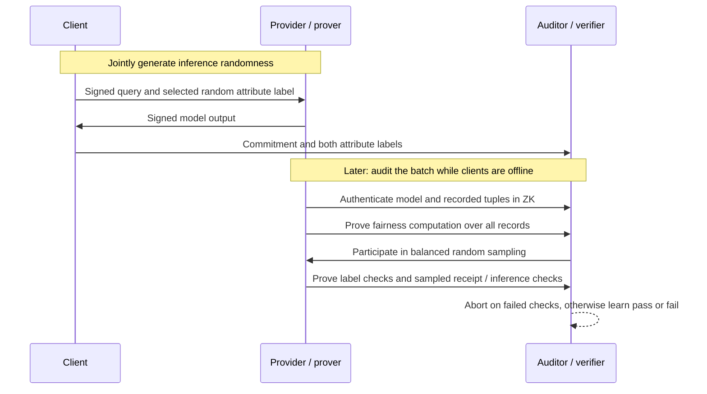

---
# Summary

**Paper:** Olive Franzese, Ali Shahin Shamsabadi, Carter Luck and Hamed Haddadi, *Secure and Confidential Certificates of Online Fairness*. The linked PDF is arXiv:2410.02777v2, dated October 2025, and labels itself a preprint under review. Its proposed protocol is **OATH**. Code: [cleverhans-lab/oath-zk-online-fairness](https://github.com/cleverhans-lab/oath-zk-online-fairness).

## 1. Problem

A model may pass a fairness audit on an offline dataset but behave differently on real client queries because of distribution shift or deliberate model switching. An auditor also may not be allowed to inspect proprietary model parameters or sensitive client data. OATH asks whether fairness can be certified over the queries actually served, without exposing those inputs to the auditor or running an expensive zero-knowledge proof with every client.

## 2. Main Contribution

- Defines an **online group-fairness certificate** over a batch of deployed-service queries and their outcomes, rather than relying on an offline test set.
- Introduces a two-phase protocol: lightweight authenticated receipts during service, followed by a zero-knowledge audit between the provider and auditor after clients go offline.
- Computes the fairness statistic over the whole batch while checking model inference and receipt consistency on a group-balanced random sample. The paper bounds the probability that sufficiently large manipulation of the measured fairness gap escapes detection (Theorem 4.1, pp. 7–8).
- Gives a demographic-parity construction and an equalized-odds extension that assumes access to ground-truth labels (Appendix B).

## 3. Main Techniques

- Hash-based hiding and binding commitments and digital signatures bind each client's query and response to a receipt; jointly generated randomness limits manipulation of a probabilistic classifier.
- Interactive zero-knowledge computation uses information-theoretic MACs to authenticate hidden values, plus a zero-knowledge RAM primitive to select a balanced sample without revealing group membership directly.
- A generic zero-knowledge inference subroutine checks sampled outputs against one authenticated model. The sampling argument connects a change in the aggregate fairness gap to the chance that at least one altered record is checked.

## 4. Threat Model and Assumptions

- Parties are a service provider/prover, an auditor/verifier, and authenticated clients. The paper considers malicious behavior by individual parties but assumes **no collusion** among them, secure point-to-point channels, and protection against fake clients or Sybil attacks.
- Clients are assumed to submit truthful, representative features and sensitive attributes; checking their truth is outside the protocol. The provider sees the client query, including its sensitive attribute. OATH primarily protects client data and model details from the auditor, subject to the leakage below.
- Cryptographic claims depend on the underlying commitment, signature and ZK primitives, the random-oracle model for the hash, fair generation of model randomness, and correct integration of the inference proof. Appendix E's blame-attribution procedure explicitly requires a client to reveal its query, attribute label, response, randomness and provider signature to the auditor. A ZK alternative is suggested as future work; normal-path confidentiality does not cover this disclosure.
- The analysis presumes a fixed batch and a sample unpredictable to the prover when the audited values are fixed; each group must contain at least the required sample size. The authenticated model is fixed for the audit's inference checks. The presented pseudocode does not establish a public commitment to a particular model version before deployment, so the certificate should not be read as proving a prior training history or model provenance.

## 5. Important Qualifications

- **What is certified:** the empirical metric on the submitted online batch, with a statistical allowance for undetected tampering. It does not establish fairness for future users, unrepresented groups, individual fairness, or a complete ethical assessment. The binary-classifier and binary-sensitive-attribute formulation in the main construction is narrower than general fairness.
- **Exact fairness definition:** Definition 2.1 and Algorithm 2 use the absolute demographic-parity gap `|rate₀ − rate₁| ≤ θ` (pp. 3, 7). Definition 4.1 likewise defines both honest and measured gaps using absolute values. These bars are visible in the PDF but missing from its extracted text; this note follows the rendered equations.
- **Leakage:** despite broad introductory privacy wording, Appendix G says the basic sampling procedure reveals the two group sizes and the selected query indices, in addition to the pass/fail result. Knowing other clients' attributes can make the balanced sample reveal further information. Algorithm 7 sketches a higher-cost variant that avoids revealing the sample indices; it should not be treated as a demonstrated elimination of all leakage.
- **Equalized-odds soundness needs a separate analysis:** Theorem 4.1 is about demographic parity. Appendix B samples by demographic group, while equalized odds conditions on both demographic group and ground-truth label. If a label is rare within a group, modifying a few such records can substantially change a conditional rate while remaining unlikely to enter the sample. The demographic-parity error bound must not be reused unchanged for equalized odds. Appendix B provides a protocol but no corresponding conditional-rate soundness theorem. For example, suppose one group has 100,000 records but only 100 ground-truth negatives: changing 10 negative-label outcomes can change its false-positive rate by 0.10. A uniform sample of 3,800 from that whole group misses those 10 records with probability `C(99,990,3,800)/C(100,000,3,800) ≈ 0.679`, far above the demographic-parity expression for ε = 0.10. This is an independently checked sampling example, not a reproduced attack on its code.
- **Sampling, not constant total work:** only the number of expensive sampled checks can stay fixed as the batch grows for fixed desired error and detection probability. Authentication, fairness computation, and sampling still process the batch and scale with its size. Small or empty groups require special handling, including avoiding division by zero; the paper does not specify a general solution for these cases.
- **Source ambiguities to resolve before implementation:** Algorithm 1 constructs `H(q || αₛ || o || r)` but Algorithm 2 writes `H(q || αₛ || r || o)`; both phases need one canonical encoding and order. Algorithm 6 describes permutations on `[1,n_g]` but selects values `< ν`, while its theorem claims exactly ν per group; with one-based indices that test selects ν−1. The proof's no-hit *equality* `(1−p)^ν` corresponds to independent draws; for uniform sampling without replacement the exact probability is hypergeometric, though the same expression is a valid upper bound. These observations do not by themselves establish an attack on the intended protocol.
- **Runtime bottleneck:** the main text on p. 9 says inference correctness checking dominates, but Figure 2 on p. 10 visibly shows consistency checking far above correctness checking for logistic regression, agreeing with Appendix I.1. Hash-commitment conversion is therefore the reported bottleneck for that illustrated configuration; this does not imply it dominates for every model.

## 6. Evaluation Setup

The authors implement OATH in C++ with EMP-toolkit and simulate all parties locally on a MacBook Pro CPU. They use COMPAS, Communities and Crime, Default Credit, Adult Income, and German Credit datasets. Experiments cover logistic regression and a feed-forward neural network; larger neural-network comparisons use reported Mystique inference costs. Results below are the authors' reported figures, not independently reproduced.

- For **1,000,000 queries** and **7,600 sampled checks** (ν = 3,800 per group), Table 1 reports 0.22–0.25 s service time per query and total audit times of 82.8–84.7 min for logistic regression and 93.1–123.3 min for the feed-forward model, depending on dataset. Table values are means over three trials. The paper does not establish that 1,000,000 distinct real clients were used.
- At ε = 0.01, the paper's bound gives an evasion probability at most `(1−0.01/2)^3800 ≈ 5.34×10⁻⁹`; ν = 1,000 gives approximately `6.65×10⁻³`. This is a bound for that magnitude of gap manipulation under the stated assumptions, not a guarantee against arbitrarily small deviations.
- Figure 4 estimates 4.43 s total amortized per query and 0.23 s online for ResNet-101 (42.5 million parameters) at one million queries. Larger-network figures use inference timings from Mystique and should be read as estimates, not a separately demonstrated end-to-end deployment. FairProof checks individual fairness, so the comparison is context for cost rather than the same auditing task.

---
# Main Scheme

## OATH: committed service and sampled fairness audit

### 1. Notation

| Symbol | Meaning |
| --- | --- |
| `P`, `V`, `Cᵢ` | Service provider/prover, auditor/verifier, client i |
| `qᵢ`, `sᵢ` | Query and its binary sensitive attribute |
| `M`, `rᵢ`, `oᵢ` | Authenticated classifier, jointly generated randomness, and binary result `M(qᵢ,rᵢ)` |
| `αᵢ0`, `αᵢ1` | Client-generated random labels for sensitive-attribute consistency |
| `Γᵢ` | Auditor's hash commitment to the query, chosen label, result and randomness |
| `n_g`, `c_g` | Number of queries and positive outcomes in group `g` |
| `θ`, `ν` | Public gap threshold and sample size **per group** |
| `⟦x⟧` | Value authenticated between prover and verifier for ZK computation |

### 2. Service phase

1. Client and provider generate fair random coins `rᵢ`. The client sends `qᵢ` and only `αᵢ,sᵢ` to the provider and signs the query transcript.
2. The provider verifies the signature, evaluates `oᵢ = M(qᵢ,rᵢ)`, signs the response transcript, and returns the result. The client verifies it.
3. The client sends the auditor `Γᵢ = H(qᵢ || αᵢ,sᵢ || oᵢ || rᵢ)` and both random labels. The signatures support later blame attribution if a dispute requires it. The client's service work does not include a ZK inference proof.

### 3. Audit phase and guarantee

1. The provider authenticates the model and all recorded query-answer tuples for the interactive ZK computation. The parties compute `n_g = Σᵢ 1[sᵢ=g]` and `c_g = Σᵢ oᵢ·1[sᵢ=g]` for both groups across the batch. The pass bit in the main construction is `b = [|c₀/n₀ − c₁/n₁| ≤ θ]`.
2. Generate a uniform sample of ν records from each group using the group-balanced ZK sampling procedure. Check sensitive-attribute-label consistency for all records. For sampled records, prove that the committed receipt matches and that the output is correct inference under the authenticated model. If a check fails, abort; otherwise reveal the pass bit.
3. Let `Xₕ = |c₀ʰ/n₀ − c₁ʰ/n₁|` be the absolute gap under the paper's ideal honest record and `Xₘ = |c₀ᵐ/n₀ − c₁ᵐ/n₁|` the gap measured from the prover's submitted records. With group memberships fixed by the label checks, changing fractions `p₀` and `p₁` of the outcomes can change the gap by at most `p₀ + p₁`; thus a deviation of ε requires at least one fraction to be at least ε/2. Under the stated sampling and integrity assumptions, Theorem 4.1 bounds the chance that cheating with `|Xₕ − Xₘ| ≥ ε` escapes detection by at most `(1 − ε/2)^ν` (apart from cryptographic failure probabilities). A passing bit alone does not prove zero deviation between these gaps. In particular, if an honest gap exceeds θ by at least ε but the audit reports a gap at most θ, this is an event covered by the bound. It is not a posterior probability that an arbitrary passing service is fair.
4. For equalized odds, Appendix B instead compares group-conditioned true-positive and false-positive rates, requiring reliable ground-truth labels from an assumed oracle. The intended test is `|TP₀/P₀ − TP₁/P₁| ≤ θ` and `|FP₀/N₀ − FP₁/N₁| ≤ θ`, where `P_g` and `N_g` count ground-truth positives and negatives in group g (Algorithm 4, p. 16). These rates need nonzero denominators. Its output comments incorrectly mention demographic parity; its intended metric and its sampling guarantee must be distinguished, as discussed above.

## Protocol

---
# Questions

- How are batch completeness, duplicate queries, delayed or missing client receipts, and client authentication enforced in an actual deployment?
- How are empty and undersized demographic groups handled, and how should sampling be stratified by ground-truth label for a quantitatively sound equalized-odds audit?
- Which commitment encoding and sampling index convention does the released implementation use? Does it match the mathematical security argument?
- What are the measured network, memory, and multi-party costs for realistic deployments, and how much leakage remains when audits repeat or abort?
- How are ground-truth labels authenticated in the equalized-odds extension, especially when labels become available only after a delay?

---
# Related Topics

- Zero-knowledge proofs and verifiable machine-learning inference
- Demographic parity and equalized odds
- Online auditing, distribution shift, and model switching
- Cryptographic commitments, group-balanced sampling, and zero-knowledge RAM
